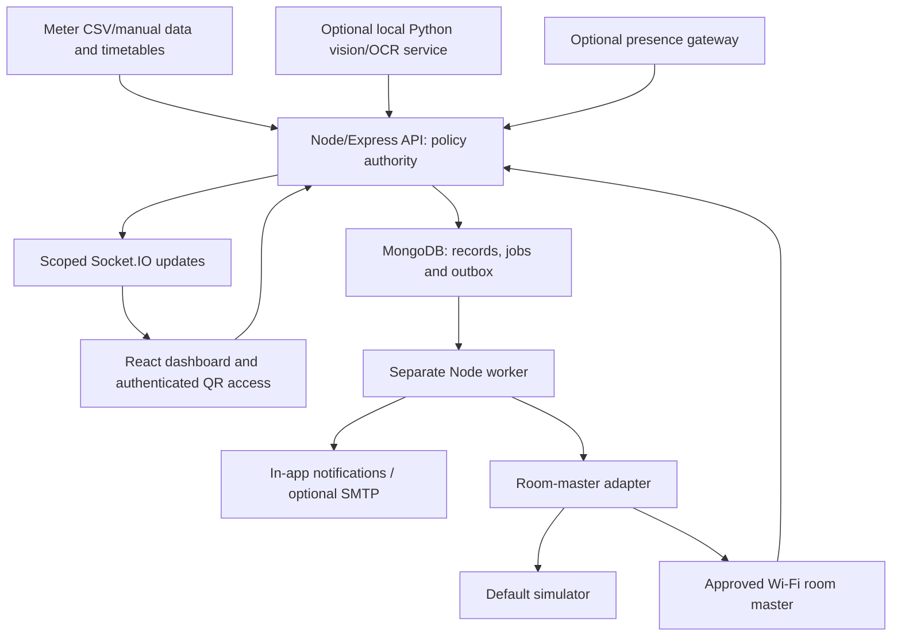

# Architecture

**Status:** Local prototype implemented in JavaScript, aligned with [PLAN.md](PLAN.md). React/Vite, Express, Mongoose/MongoDB and a separate Node worker now exist. Physical devices, live vision/OCR and external transports remain unavailable. The implementation has not been deployed or electrically commissioned; see PROGRESS.md and HANDOFF.md for current checks.

## Implemented source map

| Existing path | Responsibility |
| --- | --- |
| `frontend/src/main.jsx` | Authenticated application shell and connected overview, room, import, timetable, incident, recommendation, QR and admin screens |
| `frontend/src/components/ConsumptionChart.jsx` | Lazy-loaded building interval/expected chart |
| `frontend/src/services/api.js` | Same-origin fetch, CSRF and error handling |
| `shared/contracts.js` | Strict Zod input contracts, role names and error envelope |
| `backend/src/app.js` | HTTP routes, server sessions, role/room checks and scoped live refresh |
| `backend/src/models/index.js` | Explicit MongoDB schemas, indexes and connection factory |
| `backend/src/domain/` | Pure energy, baseline, calendar, protection and shared-cutoff rules |
| `backend/src/services/` | Ingestion, durable import previews/commit, analytics, room evidence and audit helpers |
| `backend/src/adapters/room-master.js` | Persistent idempotent simulator; all physical enablement rejected |
| `backend/src/workers/tick.js`, `run.js` | Persistent due work, recovery, notifications, source/lease checks and guarded room actions |
| `backend/src/seed.js`, `fixtures/` | Idempotent synthetic dataset/test accounts and example CSVs |
| `scripts/`, `tests/` | Local setup/database/dev orchestration and application verification |

The original plan's boundaries below remain requirements where optional integrations are absent. No alternate database, actuator or hosted architecture was introduced.

## Scope and component boundaries

One installation serves one college building and selected rooms/common areas. Building-level energy analysis, timetables, recommendations and accountable follow-up are the core; occupancy and optional control support that workflow.

| Component | Responsibility | Boundary |
| --- | --- | --- |
| React/Vite JavaScript frontend | Dashboard, imports, incidents, recommendations, QR access and admin | Uses backend APIs; no direct camera/controller credentials or policy decisions |
| Express/Node backend | Authentication, room scope, validation, ingestion, analytics, leases and control eligibility | Sole application policy authority |
| MongoDB/Mongoose | Domain records, sessions, durable work, notification intent and audits | Required for the core prototype; constraints enforced in the database |
| Separate Node worker | Claim/recheck due work, route notifications and submit expiring commands | Runs independently of the browser; restart recovery and idempotency required |
| Optional Python/FastAPI service | Approved capture, room-region inference, OCR and health | Returns observations/quality; owns no users, schedules, leases or power decisions |
| Optional presence node | LD2410/ESP32 observations and availability | Sensing only; requires a communication path and independent power |
| Device/notification adapters | Normalise simulator, supported breaker/gateway and delivery results | Exact vendor/firmware integration remains to be selected and commissioned |

The complete dependency selection is in [PLAN.md section 9](PLAN.md#9-recommended-software-stack). The core frontend/backend/database/worker path must work without Python, SMTP, MQTT, Home Assistant or physical devices. Missing optional integrations show unavailable status and do not disable analytics.

## Energy and recommendation flow

1. Preview and validate meter/timetable imports; support manual meter entry. Keep provenance, original capture time, units, format, meter epoch and acceptance/review status.
2. Difference accepted cumulative readings within the same meter epoch; sum interval inputs. Calculate average kW from interval kWh/duration. Preserve gaps and partial-day coverage, and reconcile alternative sources instead of adding them twice.
3. Compare compatible intervals using schedule/calendar context, a versioned robust baseline or an explicitly labelled initial rule. Insufficient history is visible; no invented probability or hourly points.
4. Open explainable building anomalies and attach possible contributors supported by observations. A suspected room is not a measured cause, and an unexplained spike does not select a room to shut down.
5. Assign actionable recommendations with evidence, owner, kWh/rupee ranges, assumptions and follow-up. Keep estimated benefits, observed reductions and verified savings distinct; avoid overlap. Tariffs, installed quotes and net-benefit assumptions remain editable.

Hourly cumulative readings yield interval-average power, not instantaneous demand. Optional meter images require register/decimal checks, plausible growth, burst agreement or review, explicit reset/rollover handling and accepted readings before analytics. The initial meter-camera cadence is 60 minutes. See [meter ingestion](PLAN.md#6-meter-ingestion-validation-and-calculations), [baselines](PLAN.md#7-baseline-and-anomaly-engine) and [savings](PLAN.md#8-recommendation-and-savings-engine).

## Room evidence and authorised use

Keep four separate concepts: observed occupancy (`occupied`, `vacant`, `unknown`), authorised-use protection (schedule/lease/override), controller-reported supply and appliance operating-state evidence.

A fresh credible positive occupancy protects the room. Vacancy requires validated room/zone coverage, healthy fresh sources and the configured confirmation period. Staleness, blind spots, unusable images and conflicting evidence yield unknown unless a fresh positive signal already establishes presence. Corridor presence does not establish classroom occupancy. Appliance appearance and rated watts do not establish measured room energy.

Current bookings, the initial 15-minute preparation window, valid QR leases and staff overrides protect against vacancy-based cutoff. Tomorrow's booking does not protect an unrelated idle period today. A QR scan opens an access URL; sign-in and server checks authorise the lease, duration, warning and extension without proving physical presence. Expiry removes lease protection without establishing or changing observed occupancy. In a room with no occupancy source, occupancy remains unknown and expiry defaults to a staff confirmation task. A fixed-duration physical supply policy is a separate opt-in arrangement with approved circuits and local override.

## Incidents, jobs and commands

The initial vacancy-confirmation default is 15 minutes. Only after confirmation and protection checks does the incident clock start: first responder at t=0, HOD/second responder at t=10 minutes, final eligibility check at t=25 minutes. This can mean about 40 minutes from last observed presence to final action; it is not a 25-minute timer from the first empty frame.

Persist incident episodes, due jobs, policy versions, worker leases and notification outbox records. Atomically claim work, reload current evidence/protection/interlocks, invalidate obsolete actions, persist intent, then dispatch with bounded retries and deadlines. Recover expired worker leases after restart. Use at-least-once assumptions and database-enforced deduplication; provider acceptance, delivery, acknowledgement, resolution and physical outcome are distinct.

A person, booking, QR lease, override, stale evidence or policy change can cancel pending OFF work. Revalidate after acquiring a command lock. Acknowledgement alone does not resolve an issue, and snooze expiry requires fresh evaluation. Persist explicit ON/OFF commands and result verification; never toggle supply or replay expired work. See [scheduler and incident lifecycle](PLAN.md#15-persistent-scheduler-incident-states-and-command-handling), [API.md](API.md) and [DATABASE.md](DATABASE.md).

## One master breaker per controlled room

Map exactly one suitable Wi-Fi smart master breaker to each controlled room; different rooms remain independently controllable. All approved downstream ordinary loads switch together. Inventory and estimated load breakdowns do not create per-appliance actuators. Existing physical switches and appropriate lighting/socket/AC branch protection remain.

An electrician must establish the feeder, inspect separate/shared existing feeds and approve connected loads, ratings, switching duty and local isolation. Cameras, sensing, network/gateway and essential supplies remain available outside routine cutoff. If any downstream load is incompatible, block the entire room cutoff and retain a manual task. No ESP32 relay, smart plug, per-button module or AC IR blaster supplements this design.

AC supply interruption must match the installed model's operating instructions. Where a normal stop is required, authenticated staff confirmation must remain valid; restarting or uncertain evidence invalidates it. Enforce restart delay and other interlocks. Master ON restores electrical availability, not guaranteed operation of individual appliances.

The internal adapter exposes `getCapabilities`, `getStatus`, `setSupply` and `getCommandResult` as defined in [PLAN.md section 11.6](PLAN.md#116-room-master-adapter-contract). It translates the selected model's documented protocol; no universal vendor endpoint is assumed. Restoration applies only to eligible automation-disabled supply and must never reset a fault-tripped, maintenance-locked or manually isolated breaker. Missing required status blocks restoration or requires an approved manual procedure.

## Simulation and deployment

Rooms begin alert-only; device commands default to the simulator. Server and gateway enforce demo/physical-control isolation. Replayed footage, synthetic data and accelerated clocks retain their provenance and cannot authorise physical switching. Even controller-like feedback in a simulated result remains simulated. Actual outcome labels distinguish command-only, controller-reported, independently metered, manual and unknown verification.

Run the planned API, worker and MongoDB on a continuously running local host, optionally with Python. The built frontend can share the API origin. QR phones need a reachable URL; local operation can work without internet, while cloud email/cloud-only devices may not.

Live cameras and breakers need an authorised reachable local gateway. A cloud dashboard cannot reach private camera addresses merely by storing them. If hosted remotely, use authenticated outbound gateway communication, scoped credentials and expiry checks; do not expose raw CCTV or unrestricted device endpoints. A presence node with no link can only sense locally, and a Wi-Fi-only breaker without a reachable network cannot receive central commands.

## Implementation structure and open decisions

[PLAN.md section 19.1](PLAN.md#191-suggested-repository-layout) proposes the wider layout. `frontend/`, `backend/`, `shared/`, `fixtures/`, `tests/` and `scripts/` now exist. `vision/`, `firmware/` and `docs/` have not been created; existing root documents remain the entry points.

Installed dependency versions are pinned in manifests/lockfile. API gaps were resolved for import commit, inspection/reassignment, recommendation scheduling/outcome review, user creation and the in-app inbox without changing approved product scope. Import previews use the additional `importBatches` collection; in-app inbox state lives in `notificationOutbox`. Shared room locks serialize policy mutations and simulated commands; jobs use atomic leasing and deterministic IDs, with reconciliation for partial incident/job creation. Operations are at-least-once row/document writes, not cross-collection transactions. Room creation has bounded compensating cleanup; multi-process transaction/lock hardening remains future work.

Manual meter review, reset-epoch configuration and staff normal-stop confirmation are implemented with retained evidence. Still pending: real input/tariff validation, model/licence selection, image/vision/OCR processing, exact breaker/firmware/gateway, physical coverage/commissioning, external transports and installed quotes. Socket.IO sends authenticated refresh signals without room payloads; clients refetch scoped HTTP data. The API validates room subscriptions and active sessions. [TASKS.md](TASKS.md) and [TESTING.md](TESTING.md) distinguish completed checks from remaining acceptance work.

Operational follow-up includes source uptime, OCR review/gaps, false-alert reviews, response times, command verification, recommendation outcomes and baseline age. Revalidate coverage/mappings after room or wiring changes. Commercial subscriptions, savings-performance contracts and ESG reporting in the plan describe future evaluation; they do not expand this single-building MVP.
