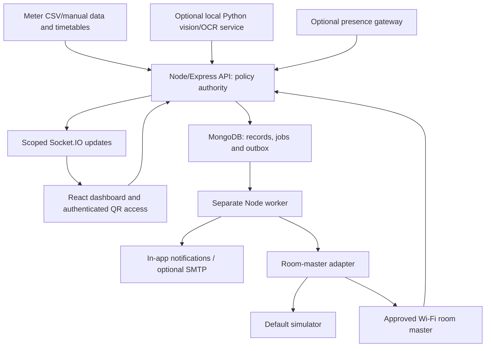

# Architecture

## Dedicated meter source and OCR (CE-016)

A separate MeterCamera service/routes/capability domain reuses existing institution context, static phone hosting, bounded image encoder, worker and change journal. Meter imagery never enters occupancy inference. The worker persists hourly capture requests; the paired source only satisfies unexpired server requests. Manual authenticated image tests are also supported; arbitrary website/RTSP URLs are not.

Node invokes a bounded local Python/Tesseract worker, applying orientation/ROI and returning raw text/scores. Parser, neighbour/time/plausibility/decimal checks and review remain backend-owned. Immutable evidence is stored separately from accepted cumulative readings, then the existing energy importer/calculator handles accepted values. Manual review enters the core as needs_review until the existing audited validator accepts it; failed review cannot briefly create anomalies. Automatic acceptance requires explicit tested configuration and never guarantees accuracy. Image retention is latest12 pairs/camera24h with a site budget; separate metadata/audit survives expiry. See [METER_CAMERA.md](METER_CAMERA.md).

## Persisted change feed and frontend reconciliation (CE-014)

Existing Socket.IO, MongoDB and shared App/useData version state remain. backend/src/realtime/journal.js installs operational Mongoose post-write hooks before model compilation. Successful saves, query writes/deletes, insertMany and bulk imports append minimal syncEvents after the operational write; syncCounters allocates revisions per database. Lock-only/timestamp-only/no-op writes do not create refresh loops. Room remapping invalidates both old and new scoped views. Raw migration writes are deliberately offline; direct database edits outside application models require snapshot repair. No change-stream/Redis/replica-set dependency was added.

transport.js tails the same journal from each API process (600ms batches), so separate worker/provider connections produce equivalent invalidations. Each socket is reauthorised before dispatch; permission changes clear room subscriptions, expiry/revocation disconnects. Broadcasters never trust a client institution ID, mutate control policy or publish stored document/credential bodies. Floor/configuration events are restricted to their existing admin access; institution display-name updates use unchanged immutable IDs and reach member labels.

frontend/src/services/live-sync.js owns one socket per authenticated App. Revision ordering, 120ms coalescing, abort/generation checks and exact handler cleanup prevent duplicate work and stale overwrite. No cross-tab channel is required: each tab/user uses the server independently. Existing useData hooks refetch on invalidation; failed reads clear stale protected page data, and active-read tracking distinguishes updating/unavailable data from a connected transport. Profile, institution identity and phone-demo admin pages now participate instead of relying on one-shot/polling state. UI clocks do not schedule controls.

Reconnect, foreground/focus and 15s repair reconcile identity/checkpoint and mounted authorised resources. A stale in-flight checkpoint cannot apply after a newer event; aborted responses cannot apply after disconnect/unmount. The connection banner distinguishes connecting, synchronising, updating, disconnected/stale/background and connected; a 5s missing-heartbeat limit avoids presenting a silent channel as current. Operational writes and journal append are not a Mongo transaction: a crash/journal outage may lose an invalidation; backend snapshots repair it without replaying a physical command. TTL is 24h. Bounded feed batches and 1,001-row query capture suit this MVP; large bulk/admin operations may rely on repair snapshots. Production scale/retention tuning remains operator work.

## Independent institution workspaces (CE-013)

The approved scope now permits multiple independent institution workspaces, each with one building. No portfolio aggregation or cross-building comparison was added. backend/src/workspaces provides the shared account/membership directory, immutable identity, migration, scoped auth and runtime. AsyncLocalStorage supplies fail-closed trusted request context; operational models use a separate database per institution on the existing MongoDB deployment. Provider/phone caches bind actual models rather than a shared mutable global scope. Workers enumerate active institutions with separate tick/locking context; one workspace failure does not starve another. Sessions, sockets, ingestion and public capabilities are separately validated and institution-qualified. Existing controllers/interlocks stay unchanged.

Global email uniqueness is preserved. Display names never form authorization keys. New admin onboarding is empty and private. An explicit dedicated demo institution owns its simulated samples and configured administrator/viewer identities; startup does not seed. Existing original data remains in a legacy workspace through an operator-reviewed, resumable migration. See [INSTITUTIONS.md](INSTITUTIONS.md), [API.md](API.md) and [DATABASE.md](DATABASE.md).

## Two-phone demonstration (CE-011)

`demo/cctv-camera/` uploads sampled video-only pixels; `demo/circuit-board/` illustrates loads and acts as the existing room-master simulator's visible endpoint. PhoneDemo.jsx provides admin session/evidence/command controls. `phone-demo-routes.js`, `services/phone-demo.js` and shared phone contracts use existing Express/Mongo/auth/Socket.IO. No second database, auth provider, policy engine or scheduler is introduced.

`adapters/demo-vision.js` runs bounded local Python `vision/demo_worker.py`: OpenCV QR pixels for instrumented demo, positive-only HOG people detection otherwise unknown. Explicit injection is separate. Captured/source/quality/versioned observations remain simulated and enter existing temporal roomContext. Signed markers prevent accidental cross-session binding; they are demonstration conventions, not camera attestation. Presenter scenario selection never directly supplies a camera result.

Admin sessions temporarily assign one dedicated demo source, separate vacancy confirmation and persisted 10s/+15s timing. Existing bookings, leases, overrides, inventory/AC/critical/native prerequisites, faults and restoration checks remain authoritative. The same worker/job collection escalates. Native room policy must be alert-only; demo paths never select a live adapter.

`adapters/demo-classroom.js` extends the existing simulator with created/sent/application-acknowledged/expired/unverified commands; `simulated-supply.js` shares durable supply application with the original simulator. Policy is checked at queue, delivery and ACK. Backend supply changes only after valid classroom ACK; effective loads follow master AND local switch. Later camera OFF pixels are separate evidence. Reconnect resynchronises state, expired work is not replayed and stopping never automatically energises supply. See [DEMO_SETUP.md](DEMO_SETUP.md) for commands/HTTPS and physical checks still required.

## Approved native-OFF extension (CE-010)

The existing single-building room-master design now has an optional, separate native-device OFF path for reviewed existing equipment. `connected-device-routes.js`, `services/connected-devices.js`, the HA/simulator adapters and `shared/native-contracts.js` own setup, discovery/binding, permission gates, command lifecycle and state reconciliation. See [HOME_ASSISTANT.md](HOME_ASSISTANT.md) for current protocols, configuration, source versions/licences and remaining physical acceptance work.

The existing worker still creates first/second/final escalation jobs. At the final stage, an enabled native room policy plans explicit appliance OFF jobs in the same collection with `kind: native_off`; the legacy room-master job consumer excludes that kind. A native attempt never initiates breaker fallback. Native jobs use room locks, atomic leases, current policy/device/connection revisions, short fixed expiry and durable command records. Restarted dispatched work is read/reconciled rather than blindly re-sent. Required native inventory prerequisites also block dependent master OFF.

Connection/device allowlists and source/room protection live on the server. Default simulation makes no live calls. Read-only HA setup is allowed independently; actual native OFF requires the new server gate outside demo mode, connection permission, reviewed target/load, a successful explicit test and per-device/room automatic permission. Physical room-master controls remain uncommissioned. Encrypted bearer credentials stay server-side, gateway sockets use approved DNS pins, and reconnect snapshots cannot overwrite newer state events. Provider-reported OFF is not physical/metred verification or measured savings.

The UI has a dedicated Connected Devices route and admin module for connections, candidates, room/inventory mapping, manual ID registration, review, explicit OFF tests, automatic permission, history, simulation and disconnect. No extra database or home-automation installation is introduced; direct assistant/mobile/cloud adapters remain deferred.

**Status:** Local prototype implemented in JavaScript, aligned with [PLAN.md](PLAN.md). React/Vite, Express, Mongoose/MongoDB and a separate Node worker now exist. Physical room hardware, general CCTV/RTSP/OCR and external transports remain uncommissioned; the separate phone-demo pixel pipeline is implemented. The implementation has not been deployed or electrically commissioned; see PROGRESS.md and HANDOFF.md for current checks.

## Implemented source map

| Existing path | Responsibility |
| --- | --- |
| `frontend/src/main.jsx` | Authenticated application shell and connected overview, room, import, timetable, incident, recommendation, QR and admin screens |
| `frontend/src/components/ConsumptionChart.jsx` | Lazy-loaded building interval/expected chart |
| `frontend/src/services/api.js` | Same-origin fetch, CSRF and error handling |
| `shared/contracts.js` | Strict Zod input contracts, role names and error envelope |
| `backend/src/app.js` | HTTP routes, server sessions, role/room checks and scoped live refresh |
| `backend/src/models/index.js` | Explicit MongoDB schemas, indexes and connection factory |
| `backend/src/domain/` | Pure energy, baseline, calendar, protection and shared-cutoff rules |
| `backend/src/services/` | Ingestion, durable import previews/commit, analytics, room evidence and audit helpers |
| `backend/src/adapters/room-master.js` | Persistent idempotent simulator; all physical enablement rejected |
| `backend/src/workers/tick.js`, `run.js` | Persistent due work, recovery, notifications, source/lease checks and guarded room actions |
| `backend/src/seed.js`, `fixtures/` | Idempotent synthetic dataset/test accounts and example CSVs |
| `scripts/`, `tests/` | Local setup/database/dev orchestration and application verification |

The original plan's boundaries below remain requirements where optional integrations are absent. No alternate database, actuator or hosted architecture was introduced.

## Scope and component boundaries

One installation serves one college building and selected rooms/common areas. Building-level energy analysis, timetables, recommendations and accountable follow-up are the core; occupancy and optional control support that workflow.

| Component | Responsibility | Boundary |
| --- | --- | --- |
| React/Vite JavaScript frontend | Dashboard, imports, incidents, recommendations, QR access and admin | Uses backend APIs; no direct camera/controller credentials or policy decisions |
| Express/Node backend | Authentication, room scope, validation, ingestion, analytics, leases and control eligibility | Sole application policy authority |
| MongoDB/Mongoose | Domain records, sessions, durable work, notification intent and audits | Required for the core prototype; constraints enforced in the database |
| Separate Node worker | Claim/recheck due work, route notifications and submit expiring commands | Runs independently of the browser; restart recovery and idempotency required |
| Optional Python/FastAPI service | Approved capture, room-region inference, OCR and health | Returns observations/quality; owns no users, schedules, leases or power decisions |
| Optional presence node | LD2410/ESP32 observations and availability | Sensing only; requires a communication path and independent power |
| Device/notification adapters | Normalise simulator, supported breaker/gateway and delivery results | Exact vendor/firmware integration remains to be selected and commissioned |

The complete dependency selection is in [PLAN.md section 9](PLAN.md#9-recommended-software-stack). The core frontend/backend/database/worker path must work without Python, SMTP, MQTT, Home Assistant or physical devices. Missing optional integrations show unavailable status and do not disable analytics.

## Energy and recommendation flow

1. Preview and validate meter/timetable imports; support manual meter entry. Keep provenance, original capture time, units, format, meter epoch and acceptance/review status.
2. Difference accepted cumulative readings within the same meter epoch; sum interval inputs. Calculate average kW from interval kWh/duration. Preserve gaps and partial-day coverage, and reconcile alternative sources instead of adding them twice.
3. Compare compatible intervals using schedule/calendar context, a versioned robust baseline or an explicitly labelled initial rule. Insufficient history is visible; no invented probability or hourly points.
4. Open explainable building anomalies and attach possible contributors supported by observations. A suspected room is not a measured cause, and an unexplained spike does not select a room to shut down.
5. Assign actionable recommendations with evidence, owner, kWh/rupee ranges, assumptions and follow-up. Keep estimated benefits, observed reductions and verified savings distinct; avoid overlap. Tariffs, installed quotes and net-benefit assumptions remain editable.

Hourly cumulative readings yield interval-average power, not instantaneous demand. Optional meter images require register/decimal checks, plausible growth, burst agreement or review, explicit reset/rollover handling and accepted readings before analytics. The initial meter-camera cadence is 60 minutes. See [meter ingestion](PLAN.md#6-meter-ingestion-validation-and-calculations), [baselines](PLAN.md#7-baseline-and-anomaly-engine) and [savings](PLAN.md#8-recommendation-and-savings-engine).

## Room evidence and authorised use

Keep four separate concepts: observed occupancy (`occupied`, `vacant`, `unknown`), authorised-use protection (schedule/lease/override), controller-reported supply and appliance operating-state evidence.

A fresh credible positive occupancy protects the room. Vacancy requires validated room/zone coverage, healthy fresh sources and the configured confirmation period. Staleness, blind spots, unusable images and conflicting evidence yield unknown unless a fresh positive signal already establishes presence. Corridor presence does not establish classroom occupancy. Appliance appearance and rated watts do not establish measured room energy.

Current bookings, the initial 15-minute preparation window, valid QR leases and staff overrides protect against vacancy-based cutoff. Tomorrow's booking does not protect an unrelated idle period today. A QR scan opens an access URL; sign-in and server checks authorise the lease, duration, warning and extension without proving physical presence. Expiry removes lease protection without establishing or changing observed occupancy. In a room with no occupancy source, occupancy remains unknown and expiry defaults to a staff confirmation task. A fixed-duration physical supply policy is a separate opt-in arrangement with approved circuits and local override.

## Incidents, jobs and commands

The initial vacancy-confirmation default is 15 minutes. Only after confirmation and protection checks does the incident clock start: first responder at t=0, HOD/second responder at t=10 minutes, final eligibility check at t=25 minutes. This can mean about 40 minutes from last observed presence to final action; it is not a 25-minute timer from the first empty frame.

Persist incident episodes, due jobs, policy versions, worker leases and notification outbox records. Atomically claim work, reload current evidence/protection/interlocks, invalidate obsolete actions, persist intent, then dispatch with bounded retries and deadlines. Recover expired worker leases after restart. Use at-least-once assumptions and database-enforced deduplication; provider acceptance, delivery, acknowledgement, resolution and physical outcome are distinct.

A person, booking, QR lease, override, stale evidence or policy change can cancel pending OFF work. Revalidate after acquiring a command lock. Acknowledgement alone does not resolve an issue, and snooze expiry requires fresh evaluation. Persist explicit ON/OFF commands and result verification; never toggle supply or replay expired work. See [scheduler and incident lifecycle](PLAN.md#15-persistent-scheduler-incident-states-and-command-handling), [API.md](API.md) and [DATABASE.md](DATABASE.md).

## One master breaker per controlled room

Map exactly one suitable Wi-Fi smart master breaker to each controlled room; different rooms remain independently controllable. All approved downstream ordinary loads switch together. Inventory and estimated load breakdowns do not create per-appliance actuators. Existing physical switches and appropriate lighting/socket/AC branch protection remain.

An electrician must establish the feeder, inspect separate/shared existing feeds and approve connected loads, ratings, switching duty and local isolation. Cameras, sensing, network/gateway and essential supplies remain available outside routine cutoff. If any downstream load is incompatible, block the entire room cutoff and retain a manual task. No ESP32 relay, smart plug, per-button module or AC IR blaster supplements this design.

AC supply interruption must match the installed model's operating instructions. Where a normal stop is required, authenticated staff confirmation must remain valid; restarting or uncertain evidence invalidates it. Enforce restart delay and other interlocks. Master ON restores electrical availability, not guaranteed operation of individual appliances.

The internal adapter exposes `getCapabilities`, `getStatus`, `setSupply` and `getCommandResult` as defined in [PLAN.md section 11.6](PLAN.md#116-room-master-adapter-contract). It translates the selected model's documented protocol; no universal vendor endpoint is assumed. Restoration applies only to eligible automation-disabled supply and must never reset a fault-tripped, maintenance-locked or manually isolated breaker. Missing required status blocks restoration or requires an approved manual procedure.

## Simulation and deployment

Rooms begin alert-only; device commands default to the simulator. Server and gateway enforce demo/physical-control isolation. Replayed footage, synthetic data and accelerated clocks retain their provenance and cannot authorise physical switching. Even controller-like feedback in a simulated result remains simulated. Actual outcome labels distinguish command-only, controller-reported, independently metered, manual and unknown verification.

Run the planned API, worker and MongoDB on a continuously running local host, optionally with Python. The built frontend can share the API origin. QR phones need a reachable URL; local operation can work without internet, while cloud email/cloud-only devices may not.

Live cameras and breakers need an authorised reachable local gateway. A cloud dashboard cannot reach private camera addresses merely by storing them. If hosted remotely, use authenticated outbound gateway communication, scoped credentials and expiry checks; do not expose raw CCTV or unrestricted device endpoints. A presence node with no link can only sense locally, and a Wi-Fi-only breaker without a reachable network cannot receive central commands.

## Implementation structure and open decisions

[PLAN.md section 19.1](PLAN.md#191-suggested-repository-layout) proposes the wider layout. `frontend/`, `backend/`, `shared/`, `fixtures/`, `tests/`, `scripts/`, `vision/` and `demo/` exist. `firmware/` and a separate `docs/` tree remain absent. Vision implements the bounded phone demo, not general RTSP/OCR deployment.

Installed dependency versions are pinned in manifests/lockfile. API gaps were resolved for import commit, inspection/reassignment, recommendation scheduling/outcome review, user creation and the in-app inbox without changing approved product scope. Import previews use the additional `importBatches` collection; in-app inbox state lives in `notificationOutbox`. Shared room locks serialize policy mutations and simulated commands; jobs use atomic leasing and deterministic IDs, with reconciliation for partial incident/job creation. Operations are at-least-once row/document writes, not cross-collection transactions. Room creation has bounded compensating cleanup; multi-process transaction/lock hardening remains future work.

Manual meter review, reset-epoch configuration and staff normal-stop confirmation are implemented with retained evidence. Still pending: real input/tariff validation, field model/coverage validation, general RTSP/OCR processing, exact breaker/firmware/gateway, physical coverage/commissioning, external transports and installed quotes. Socket.IO sends authenticated refresh signals without room payloads; clients refetch scoped HTTP data. The API validates room subscriptions and active sessions. [TASKS.md](TASKS.md) and [TESTING.md](TESTING.md) distinguish completed checks from remaining acceptance work.

Operational follow-up includes source uptime, OCR review/gaps, false-alert reviews, response times, command verification, recommendation outcomes and baseline age. Revalidate coverage/mappings after room or wiring changes. Commercial subscriptions, savings-performance contracts and ESG reporting in the plan describe future evaluation; they do not expand this single-building MVP.

CE-013 documentation checked 14 November 2026 through Context7: Mongoose 9.12.1 uses cached useDb connections with separately registered models (https://mongoosejs.com/docs/connections.html); Socket.IO 4.8.4 uses independent Managers for separate test identities and handshake-only session middleware with explicit periodic membership reload (https://socket.io/docs/v4/client-api/ and https://socket.io/docs/v4/middlewares/). Existing pinned dependencies/licenses were retained; no new package was installed.

CE-014 checked current official documentation through Context7 on14 November2026: Mongoose9.12.1 post document/query/model middleware (https://mongoosejs.com/docs/middleware.html); Socket.IO4.8.4 ordering/at-most-once delivery and unload lifecycle (https://socket.io/docs/v4/delivery-guarantees/ and https://socket.io/docs/v4/client-options/). Existing pinned dependencies retained; no added package. The browser harness uses documented Chrome DevTools Protocol page targets/offline/foreground commands; its legacy network-emulation command is still supported by installed Chrome but deprecated upstream.

## CE-017 consumption read views

`frontend/src/services/consumption.js` owns whole-interval selection, comparison/status, exact linear crossing insertion, continuity breaks, totals, quality/freshness descriptions and CSV serialization. Existing Recharts renders the resulting green/red/neutral series and dashed baseline without value animations. Synthetic crossing vertices carry no accepted-reading identity and do not appear in tables/exports. Native dialog details share the selected original records with the chart. `components/Help.jsx` provides delayed pointer help, keyboard/tap activation, viewport-aware placement, dismissal and cleanup; help does not move/trap focus.

Interval API provenance is joined from existing reading IDs. Completed analytics recalculation emits a minimal journal invalidation on its own institution connection; it introduces no new real-time transport or browser calculation authority for anomalies/control. Existing API permissions, snapshot reconciliation and alert policy remain authoritative.

## Simplified building authentication (CE-018)

Global identity and immutable memberships remain authoritative. Workspace auth accepts email/password and automatically selects one membership or creates a short-lived authorised selection session. Separate registration branches create an empty Administrator building or admit a Viewer through a verified code. workspaces/join-code.js owns secure code storage and persisted registration/rotation mutual exclusion. Authentication.jsx retains the established visual classes; InstitutionSettings provides write-only code management. Historical admission records remain but retired endpoints cannot grant membership. Control policies and existing data/roles are unchanged.
