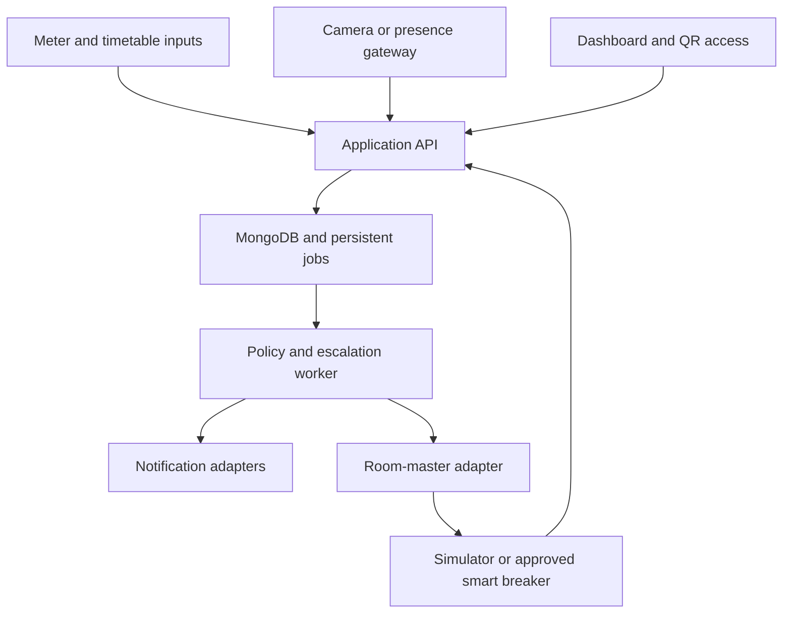

# Architecture

**Status:** design only. Nothing described here is implemented yet. Derived from [PLAN.md](PLAN.md) §3, §9–§12 and §15, which remain authoritative.

## Overview

One installation serves one college building. A Node.js backend holds all policy; a MongoDB database stores application data and the durable job queue; a separate worker runs escalation; a React frontend displays state and collects input. Vision, OCR, MQTT, email and physical control are optional integrations that the core runs without.

## Components

| Component | Responsibility | Required for core? |
| --- | --- | --- |
| Frontend (React, Vite) | Overview, Rooms, Incidents, Energy, Recommendations, QR access and Admin screens | Yes |
| Backend API (Express) | Authentication, role and room scope, imports, analytics, policy decisions, ingestion endpoints | Yes |
| MongoDB | Application data, sessions, jobs and notification outbox | Yes |
| Worker (Node) | Claims due jobs, re-evaluates eligibility, sends notifications and commands | Yes |
| Room-master adapter | Translates the internal contract into the simulator or a supported breaker interface | Simulator only |
| Vision and OCR service (Python, FastAPI) | Person detection on approved footage and meter-image OCR | No |
| MQTT broker (Mosquitto) | Transport for presence nodes and gateway events | No |
| Home Assistant | Gateway for a supported room-breaker integration when its native API is unsuitable | No |
| SMTP | External email notifications | No |
| Presence node (LD2410 with ESP32) | Occupancy observations only | No |

A missing optional service shows as unavailable and leaves the rest of the application working.

## Boundaries

- **The backend is the policy authority.** The browser never controls a breaker, never talks to a camera with embedded credentials, and never decides to cut power.
- **The vision service observes; it does not decide.** It owns no users, access, escalation, schedules or power decisions. Uploaded clips run in replay mode and cannot supply live control evidence.
- **Presence nodes are observation devices.** An ESP32 is not a second mains actuator.
- **Adapters hide manufacturers.** The rest of the system sees only normalised contracts, never device addresses or credentials.

## Room master control

Each controlled room maps to exactly one Wi-Fi smart master breaker, for example room R101 to `BRK-R101`. Opening it removes supply from every ordinary load behind it; closing it restores supply, after which wall switches and appliance restart behaviour decide what actually runs. Software cannot switch a single appliance.

Internal adapter contract, implemented identically by the simulator:

~~~text
getCapabilities(roomBreakerId)
getStatus(roomBreakerId)
setSupply(roomBreakerId, on, requestId, expiresAt)
getCommandResult(requestId)
~~~

Consequences for the design:

- If any downstream load is not approved for shared cutoff, the whole room cutoff is blocked and a manual task is created.
- An AC that requires a normal stop before breaker switching blocks the cutoff until staff confirm the stop through an authenticated task.
- Cameras, sensors, the gateway, network equipment and emergency circuits stay on a separately maintained supply so the system can still observe entry and restore power.
- Only a supply the application deliberately opened may be restored automatically. Fault trips and maintenance isolation block restoration.
- A breaker that only reports ON/OFF does not establish room kWh.

## Evidence model

The backend keeps four separate facts per room and never merges them:

1. Observed occupancy: occupied, vacant or unknown.
2. Authorised-use protection: schedule, access lease or override.
3. Controller-reported supply state.
4. Appliance operating-state evidence.

Any fresh credible occupied signal protects the room. Vacant requires validated coverage and healthy sources for the whole vacancy period. Stale, missing, contradictory or partial evidence yields unknown, which blocks automatic shutdown. An expired QR lease or a cancelled class is not an occupancy observation.

Every record carries a source label (Metered, Camera-observed, Sensor-reported, Estimated, Simulated, Unknown) and a `dataMode` that is preserved through the whole pipeline.

## Escalation and durable jobs

Escalation timing is stored, not held in memory:

| Relative time | Action |
| --- | --- |
| t = 0 | Save incident and evidence; notify the first responder |
| t = 10 min | If still eligible and unresolved, notify the HOD or second responder |
| t = 25 min | Recheck everything; send the approved OFF, simulate it, or leave a manual task |

The clock starts only after vacancy is confirmed (default 15 minutes) and schedule and override checks pass, so the earliest final action is about 40 minutes after the last detected occupancy.

The worker polls a MongoDB jobs collection. For each due job it claims a lease atomically, reloads current occupancy, schedule, leases, overrides, device health and policy version, cancels obsolete work, persists intent with an idempotency key, executes through the adapter with a deadline, and records the result. After a restart it recovers expired leases and re-evaluates overdue jobs instead of replaying old commands. Delivery is at-least-once; the design does not claim exactly-once physical execution. One worker process is used for the hackathon build.

Incident states and the full final-command eligibility list are in PLAN.md §15.2 and §15.3.

## Energy analytics

- Cumulative readings are differenced within one meter epoch; interval inputs are summed. Gaps stay as one aggregate interval, not invented hourly points.
- Baselines are deterministic: median and median absolute deviation over at least eight compatible intervals, falling back to an administrator-configured "initial rule baseline", or "insufficient baseline data".
- An anomaly is a review signal. An unexplained building spike never triggers a room shutdown.
- Recommendations are for human review, with non-overlapping savings estimates.

Formulas are in PLAN.md §6.3, §7.1 and §8.3.

## Topologies

**Demo.** API, worker, MongoDB and optional vision service run on one laptop. The built frontend is served by the Node server on the same origin. A phone on the same network exercises QR access. All room masters are simulated. Time acceleration is allowed only in isolated simulation mode and is shown on screen.

**Real installation.** A local gateway on the building network reaches the CCTV/NVR and controllers, processes footage locally and forwards compact observations over an authenticated outbound connection. Raw CCTV ports and device control are never exposed to the internet. Expired commands are not replayed when connectivity returns.

**Connectivity limits.** The breaker needs network coverage at its actual location, which may be the electrical panel. A Wi-Fi-only breaker with no reachable network has no remote ON/OFF. A presence node with no link can detect locally but cannot alert or control. Full operation with no network would be a different hardware design (PLAN.md §11.8).

## Planned code layout

| Path | Contents |
| --- | --- |
| `frontend/src/pages/`, `components/`, `services/` | Screens, shared UI, API and Socket.IO clients |
| `backend/src/routes/` | Validated endpoints |
| `backend/src/models/` | Mongoose schemas and indexes |
| `backend/src/policies/` | Occupancy, schedule protection and command eligibility |
| `backend/src/services/` | Ingestion, baselines, anomalies, recommendations and leases |
| `backend/src/adapters/` | Room-master simulator, smart-breaker or gateway, MQTT telemetry and notifications |
| `backend/src/workers/` | Job and outbox processing |
| `backend/src/security/` | Sessions, roles, scoped ingestion and secret handling |
| `vision/app/` | FastAPI service |
| `firmware/`, `shared/`, `fixtures/`, `tests/`, `docs/` | As described in PLAN.md §19.1 |

## Undecided design points

PLAN.md does not settle these; they need a decision during implementation.

- The mechanism for demo time acceleration alongside `dueAt`-driven jobs.
- Sharing the session with the Socket.IO handshake for per-subscription role and room checks.
- The person-detection model.
- The smart-breaker model and its integration route.

Related documents: [API.md](API.md), [DATABASE.md](DATABASE.md), [SECURITY.md](SECURITY.md).
