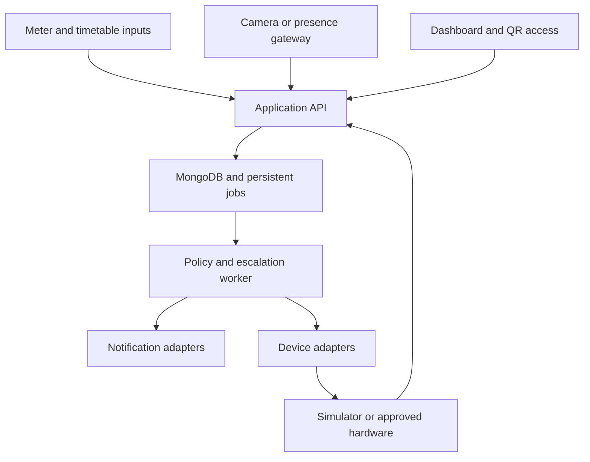

# Campus Energy Monitoring and Optimisation — Complete Implementation Plan

**Prepared:** 13 November 2026  
**Deliverable:** A working software prototype for a 24-hour hackathon, with documented paths to real hardware integration.  
**Implementation language:** JavaScript for the web application; Python only for computer vision and OCR.  
**Agreed scope:** One college building, its rooms and selected common areas. Multiple-building operation, building comparisons, and expansion to facilities with different operating-hour policies are excluded from this implementation, as requested.

**Confirmed control architecture:** One independently controlled Wi-Fi smart master circuit breaker for each room. It switches that room's mapped ordinary loads together, including lights, fans, sockets and AC where approved for this operating method. No per-button smart modules, per-appliance smart switches, smart plugs, or AC IR blaster are part of this design. Existing physical switches and appropriate downstream protection remain.

### Quick navigation

| Read this for | Section |
| --- | --- |
| The end-to-end operating flow | [5. Complete final workflows](#5-complete-final-workflows) |
| Meter data, OCR and energy calculations | [6. Meter ingestion](#6-meter-ingestion-validation-and-calculations) |
| Anomalies, recommendations and savings | [7. Baselines](#7-baseline-and-anomaly-engine) and [8. Recommendations](#8-recommendation-and-savings-engine) |
| Software and hardware connections | [9. Stack](#9-recommended-software-stack) through [13. Contracts](#13-backend-api-and-event-contracts) |
| Reliable alerts and switching | [15. Scheduler and command handling](#15-persistent-scheduler-incident-states-and-command-handling) |
| What to build during the hackathon | [20. Execution plan](#20-time-boxed-24-hour-execution-plan) |
| How to verify and demonstrate it | [21. Acceptance checks](#21-acceptance-checks) and [22. Demonstration](#22-demonstration-script-and-seeded-scenarios) |
| Costs and commercial plan | [23. Budget](#23-budget-purchasing-and-operating-cost-plan) and [24. Business model](#24-customer-segmentation-and-business-model) |

## 1. Product objective and agreed decisions

Build an energy dashboard that combines building-level electricity records, timetables, room-use requests, and available occupancy evidence to identify avoidable usage, recommend improvements, assign action, and track the outcome.

The system must support the complete agreed workflow:

1. Observe occupancy through existing CCTV where suitable footage is available.
2. Use an optional human-presence sensor where a camera is unavailable.
3. Use authenticated QR-based temporary access where a room has neither camera nor sensor.
4. Compare apparent equipment usage with occupancy, current bookings, upcoming classes, and staff overrides.
5. Alert the assigned first responder.
6. Escalate unresolved issues after 10 minutes to the assigned HOD or second responder.
7. After a further 15 minutes, re-evaluate eligibility and optionally open that room's approved Wi-Fi smart master breaker.
8. Restore an automation-disabled supply through eligible occupancy detection, an authorised QR session, or a staff override.
9. Collect building meter readings through CSV/manual entry, an optional meter-facing camera, or supported meter telemetry.
10. Detect abnormal building consumption and investigate possible contributors without inventing room-level measurements.
11. Recommend scheduling and efficiency fixes with estimated kWh and rupee benefits.
12. Track incidents, human actions, command results, data quality, and measured or estimated outcomes.

The admin panel includes staff assignments, escalation rules, room policies, one room-to-master-breaker mapping, the inventory of loads behind it, schedules, authorised QR access, tariffs, installation-budget estimates, and integration health.

### 1.1 Required distinction between prototype and installation

- The hackathon must demonstrate functioning application logic and integrations that can run with supplied data.
- Physical installation in the college electrical system is outside the 24-hour deliverable.
- Hardware commands use a simulator by default.
- A documented adapter and connection-test screen must exist for supported physical hardware.
- A simulated OFF result must never appear as a verified physical shutdown.
- Actual installation requires a qualified electrician to inspect circuits, select equipment, preserve protection, and commission the system.
- The website cannot control an ordinary mechanical switch or breaker without an actuator or an existing supported smart interface.

### 1.2 Explicit exclusions

- Multiple-building or multiple-campus management and comparisons.
- A hostel/laboratory/office policy expansion programme or cross-building class consolidation.
- Training a universal appliance detector within the hackathon.
- Exact room-level electricity measurement from CCTV or one building meter.
- Facial recognition, student identity recognition from video, or attendance monitoring.
- Independent switching of individual lights, fans, sockets or ACs.
- AC IR blasters, per-button retrofit modules, smart plugs and per-appliance actuators.
- Blind shutdown of a room containing loads that have not been approved for a shared cutoff.
- Automatic reset of a fault-tripped breaker or maintenance isolation.
- A production payment/subscription checkout.
- Requiring an LLM API or paid cloud service for core functionality.

### 1.3 Authoritative room master design

One master breaker controls the common supply to one room's approved ordinary loads. Different rooms have different master breakers and remain independently controllable.

| Room | One control device | Loads behind it |
| --- | --- | --- |
| R101 | BRK-R101 | R101 lights, fans, approved sockets and approved AC supply |
| R102 | BRK-R102 | R102 lights, fans, approved sockets and approved AC supply |

The application sends one room-level ON/OFF request. Appliance inventory is for observation, estimates and shared-cutoff eligibility; it does not create independent device controls.

“One circuit per room” means one controlled room feeder/master supply. It does not mean removing branch protection or putting AC and lighting wiring behind one oversized protective rating. An electrician must preserve appropriate downstream lighting, socket and AC protection.

If the old installation supplies a room from multiple separate feeds, a suitable room feeder arrangement may require electrical changes. One smart breaker cannot control feeds that do not pass through it.

Cameras, sensors, gateway/network equipment and emergency/essential circuits remain on a separately maintained supply. Cutting a room's ordinary supply must leave the system able to observe entry and restore eligible power.

For an AC, removing its supply does remove its power. However, some manufacturers prohibit routine breaker switching during operation. No IR controller is added: the physical cutoff remains blocked until that AC's operating instructions allow the proposed method or authorised staff have completed the required stop procedure. This rule applies to the whole room master, since individual loads cannot be isolated by software in this design.

## 2. Alignment with the problem statement

Source: PS 34, “AI-Based Campus Energy Monitoring and Optimisation,” page 34 of ps_final.pdf. The specified MVP combines building-level utility and timetable data, anomaly detection, and actionable scheduling and efficiency recommendations. The commercial options include annual per-building subscriptions, meter integrations, savings-performance contracts, and ESG/carbon-reporting modules.

| Problem-statement requirement | Implementation |
| --- | --- |
| Building-level utility ingestion | CSV, manual readings, optional meter-image OCR, optional meter adapter |
| Timetable ingestion | Room schedule CSV and admin editing, including cancellations, holidays and ad hoc bookings |
| Energy dashboard | Daily/hourly consumption, expected usage, interval quality and unexplained increases |
| Anomaly detection | Explainable comparisons against relevant historical intervals or a configured initial baseline |
| Actionable optimisation | Recommendation cards, owners, prioritisation, estimated savings and follow-up |
| Measurable value | Action history and carefully labelled consumption/savings reports |

CCTV, QR access, presence sensors, escalation, and optional control are supporting features. The core energy dashboard must remain usable without those devices.

## 3. Evidence rules and operating principles

### 3.1 Never confuse these observations

| Evidence | What the system may claim | What it must not claim |
| --- | --- | --- |
| Building meter | Electricity recorded for its mapped supply | Which unmetered room consumed the electricity |
| Camera | People and observable equipment states within validated coverage | Complete occupancy or consumption outside the view |
| Radar presence sensor | Presence indication within its tested detection zone | Exact person count, identity or guaranteed room-wide coverage |
| Timetable | Expected authorised use | Proof that someone is physically present |
| QR session | An authorised request for temporary supply | Proof that the room is occupied until expiry or empty afterwards |
| Room smart breaker status | Controller-reported room supply position | Independently verified operation/consumption of each appliance |
| Rated watts multiplied by time | An equipment-based estimate | Metered room consumption or verified savings |

Every reading, chart series, recommendation and outcome carries a source label:

- **Metered:** validated energy telemetry or accepted meter readings.
- **Camera-observed:** a visual observation with timestamp and confidence.
- **Sensor-reported:** a presence or device-state report.
- **Estimated:** a baseline, rated-load calculation or proposed benefit.
- **Simulated:** generated fixtures, clip replay or device simulation.
- **Unknown:** unavailable, stale, ambiguous or insufficient evidence.

### 3.2 Conservative control defaults

- Start every room in alert-only mode.
- Automatic control requires explicit room/circuit enablement and a tested adapter.
- Positive occupancy immediately blocks pending vacancy shutdown.
- Unknown occupancy blocks occupancy-driven automatic shutdown.
- Keep cameras, sensors, controllers, network equipment and emergency lighting outside the routine cutoff.
- Human or timetable changes cancel or invalidate pending actions.
- Use explicit ON and OFF commands; avoid a power-toggle command.
- Essential equipment and computers needing graceful shutdown remain outside routine power cutoff.
- Observe appliance-specific restart delays, operating requirements and load ratings.
- A timetable match must concern the current time or a short preparation window; tomorrow’s booking does not protect an empty room today.

## 4. Users, permissions and admin controls

| Role | Responsibilities and permissions |
| --- | --- |
| Administrator | Configure rooms, users, policies, integrations, tariffs, import data, enable approved control |
| HOD / second responder | View assigned department incidents, acknowledge, resolve, snooze within policy, review recommendations |
| Lab assistant / technician / first responder | Receive assigned incidents, inspect equipment, record actions and evidence |
| Teacher / authorised staff | Request room access, extend an allowed session, create an approved override, view assigned room status |
| Student / general viewer | View permitted information or request approval; no default direct power-control privilege |
| Integration service | Submit only its own camera, meter or device telemetry using a scoped service credential |

Assignments are stored against rooms or selected common-area zones. Configure first responder, backup responder, second responder and optional urgent-notification group. This is role and department assignment inside one installation, not a multi-building management feature.

Admin policy fields include:

- Vacancy confirmation period, default 15 minutes for the pilot after coverage testing.
- Escalation delays: 10 minutes, then another 15 minutes.
- Booking preparation window, initially 15 minutes.
- Sensor/camera freshness limits, configurable by source cadence.
- Supported control mode: alert-only, simulated, or approved physical control.
- Approved target circuits and essential-load exclusions.
- Maximum QR access duration, initial default 120 minutes.
- QR-expiry warning period, initial default 10 minutes.
- Physical/manual override behaviour and who can extend it.
- Source-quality thresholds and integration availability.

All initial thresholds are configuration defaults to validate during a pilot, not guaranteed universal settings.

## 5. Complete final workflows

### 5.1 Initial setup and mapping

1. Enter the building name, timezone and meter identifier.
2. Create the rooms and relevant common-area zones.
3. Add a manual appliance inventory: device name, category, approximate rated watts, essential/nonessential flag and approved control policy.
4. Map each camera view or sensor to its actual covered room/zone.
5. Record known blind spots and validate coverage with someone seated in the least visible area.
6. Map each room to exactly one smart master breaker and list all loads supplied behind it.
7. Have an electrician establish the room feeder, preserve its downstream protection, and check whether existing separate/shared feeds require changes.
8. Import schedules and assign responders.
9. Configure tariffs and baselines.
10. Test each source, run in alert-only mode, and enable only approved automatic actions after commissioning.

A device recognised in an image is not automatically a registered inventory item. An administrator confirms which room master supplies it. There is no independent software control for that appliance.

### 5.2 Occupancy and apparent waste detection

1. The camera processor samples suitable frames rather than continuously uploading all footage.
2. A person detector evaluates the configured room region, including seated people where the model and view allow it.
3. A fresh credible person detection marks the room occupied and invalidates pending vacancy actions.
4. If a calibrated camera or presence-sensor arrangement has no positive occupancy for the vacancy period, evaluate it as vacant only when all required sources remain healthy and coverage is validated.
5. Missing frames, stale telemetry, darkness that prevents detection, model failure, partial coverage or contradictory evidence produce unknown occupancy.
6. Evaluate whether any mapped nonessential equipment is apparently ON or whether a known energised supply is eligible for a waste review.
7. Check current bookings, preparation windows, holidays, cancellations, active QR leases and staff overrides.
8. Open one incident for a persistent eligible issue.

Someone in a corridor must not count as occupying a separate classroom. Use per-room/zone regions and mappings.

### 5.3 Escalation and optional automatic shutdown

The alert clock starts only after confirmed vacancy and the schedule/override checks, not at the first frame with no person.

| Relative time | Action |
| --- | --- |
| t = 0 | Save incident and evidence; notify the assigned first responder |
| t = 10 minutes | If still eligible and unresolved, notify HOD/second responder and retain the incident for the first responder |
| t = 25 minutes | Recheck all current conditions; execute approved OFF action, simulate it, or leave an alert-only/manual task |

At every stage:

1. Reload current occupancy, schedule, room-use leases, override, equipment state, integration health and policy version.
2. Stop if the equipment is already OFF, a person arrives, a relevant booking starts, a valid QR session starts, a manual override applies, or evidence becomes unknown.
3. Acknowledge does not mean resolved. A staff member can mark “inspecting,” apply a permitted time-limited snooze, or submit resolution evidence.
4. A failed notification is recorded and routed to a configured backup; it does not silently skip the remaining checks.
5. At t = 25, an unconnected room master or a downstream load incompatible with shared cutoff leaves the room as an unresolved manual task. The app must not claim a physical shutdown.
6. A physical command needs fresh evidence, an unexpired command deadline, the correct room master breaker and no interlock. Any incompatible load or required stop procedure blocks the entire room cutoff.
7. Request the resulting room-breaker state and record the level of verification.

Simultaneous incidents for the same circuit must not produce conflicting commands. Reopening an issue creates a new incident episode with a new timeline.

### 5.4 Restoring power when a person enters a camera-covered room

1. A healthy, suitably illuminated camera detects entry/presence.
2. Check whether the supply is OFF specifically because this automation previously disabled it.
3. Check room access policy, operating hours, device health, manual lockout and restart delays.
4. Restore that room's complete approved master supply if eligible, including all downstream ordinary loads. Appliance restart behaviour still applies.
5. Cancel obsolete OFF jobs and record the restoration reason.

This restores electrical availability. It does not guarantee that every appliance will resume operation: physical switches may be OFF, and some electronics require their own ON command.

Never restore a supply marked fault-tripped, maintenance-locked, manually isolated or otherwise unsafe. Manufacturer-specific breaker status must distinguish these situations.

### 5.5 Camera-free rooms with an LD2410 presence sensor

1. Power the LD2410 and its ESP32 controller from a supply that remains available when the controlled load is OFF.
2. Read the sensor through UART or the supported presence output; match the exact module’s voltage and pinout.
3. Test detection of seated people and tune range/sensitivity for the actual room.
4. With connectivity, submit timestamped presence events to the application.
5. With no Wi-Fi or other link, the ESP32 can still detect locally, but it cannot command the chosen Wi-Fi-only room breaker or send central alerts by itself.
6. Connect the presence node through shared Wi-Fi coverage or an appropriately designed wired gateway/link. The master breaker needs connectivity at its actual location, which may be the electrical panel rather than inside the room.

The bare LD2410 has no Wi-Fi. This agreed architecture uses the ESP32 as a presence-data node, not a second mains actuator. Do not introduce an ESP32 relay or a separate room switch as an alternative control architecture.

Important: without a communication path, the central escalation and Wi-Fi-breaker control workflow is unavailable. Loss of connection suspends new central automatic commands. Local sensing alone must not be presented as a functioning full control installation.

### 5.6 QR access in rooms without cameras or presence sensors

1. Display a printed QR containing an opaque room-access URL, not a control password or device IP.
2. User scans it and signs in.
3. Server checks role, permitted room, allowed hours, booking conflicts, requested duration and any lockout.
4. Create a room-use lease with a server-controlled start and expiry.
5. Enable that room's one approved master supply through its breaker adapter; QR access does not individually operate appliances.
6. Warn the requesting user before expiry and offer an authorised extension.
7. An active lease protects the room against vacancy-based shutdown.
8. Expiry removes that protection; it does not change actual occupancy to vacant.

For a room with no occupancy source:

- Default physical policy: expiry creates a staff action/confirmation request, because occupancy remains unknown.
- The dashboard can simulate a fixed-duration supply contract with advance warnings and extension.
- A physical fixed-duration cutoff is a separate opt-in policy for specifically approved circuits, accepted by authorised users and backed by a working local override. It must not be represented as proof the room became empty.
- A newly approved QR lease or manual extension cancels old expiry-related OFF work.

The QR route still needs a reachable server/network to issue central commands. A printed QR alone provides neither connectivity nor proof of physical presence; a photograph of a static QR can be shared. Do not describe authentication as proof the user is standing in the room.

### 5.7 Building energy spike detection and investigation

1. Ingest and validate energy observations.
2. Derive compatible intervals and their consumption.
3. Compare the current interval with an expected baseline using schedule and calendar context.
4. Open an anomaly incident for a sufficiently large, credible deviation.
5. Notify configured energy/facility responders; urgent broadcast is configurable rather than sending every warning to everyone.
6. Review time-aligned camera observations, active bookings and device telemetry as possible explanations.
7. Attach evidence-supported candidate contributors.
8. If no cause is established, assign a manual inspection across relevant areas, including unmonitored areas.
9. Record the inspection result and any confirmed cause.

Absence of an explanation in CCTV-covered areas does not prove the excess came from areas without CCTV.

Example alert:

> Building consumption exceeded the expected range during 14:00–15:00. Lights appear ON in Room A despite no scheduled use. This is a possible contributor, not measured room-level attribution. Inspect Room A and other relevant areas. Cause remains unconfirmed.

An unexplained building-level spike must not trigger a blind shutdown of an arbitrarily selected room.

### 5.8 Optimisation, assignment and outcome

1. Create an explainable recommendation from an observed pattern.
2. Include supporting dates, energy source, assumptions, proposed change, owner, estimated savings range and priority.
3. Allow accept, reject-with-reason, schedule, complete and verify.
4. Show later consumption alongside a comparable baseline.
5. Separate estimated benefits, observed reductions and independently verified savings.

## 6. Meter ingestion, validation and calculations

### 6.1 Supported input routes

| Route | MVP implementation | Important limitations |
| --- | --- | --- |
| Utility CSV | Upload, preview, validate and commit | Monthly bills cannot support hourly spike detection |
| Manual entry | Timestamped reading form with provenance | Record corrections and who entered them |
| Meter-facing camera | Upload images or optional camera polling and OCR | Focus, glare, changing display registers and OCR errors require validation |
| Existing meter telemetry | Adapter for a documented meter/API/gateway if available | Register units and meter coverage must be confirmed |

No external meter API is assumed to exist. Use imports and manual entries as the guaranteed working path.

### 6.2 Meter-facing camera workflow

Use one fixed small camera facing the building’s main electricity meter. Default capture cadence is 60 minutes, as agreed. Capture a short burst if needed to find the correct display register.

1. Record meter ID, cumulative-import kWh register, decimal format, register identifier if shown, and any actual display multiplier.
2. Mount externally with suitable focus and lighting without opening, altering or obscuring the utility meter.
3. Configure a reading region and reference image.
4. Capture timestamped frames and identify the intended kWh register.
5. Extract the digits with OCR.
6. Check agreement between multiple usable frames and validate the result.
7. Store the raw text, selected image reference, parsed value, capture time, receipt time, OCR quality and validation status.
8. Re-capture or request review when ambiguous.
9. Use only accepted readings in measured charts and anomaly calculations.

AI on the Edge Device is an optional ESP32-CAM implementation to evaluate, with its MQTT/REST output normalised by an adapter. Server-side OpenCV plus Tesseract is another route for uploaded meter images. Neither route is guaranteed to recognise an arbitrary meter without calibration.

Checks include:

- Correct meter and register, expected decimal placement and units.
- Duplicate capture/event rejection.
- Monotonic cumulative import readings within the same meter epoch.
- Physically plausible growth based on the actual supply limit and elapsed time.
- No timestamp far in the future or unexpected chronology.
- Explicit handling of meter replacement, counter reset and rollover.
- A significant jump triggers a repeat/read review before becoming an anomaly, not automatic rejection merely because usage is unusual.
- Missing readings remain missing; do not silently reuse an old value with a new timestamp.

Net-metering import/export registers and multipliers require explicit configuration if present. Do not treat exported energy or apparent energy as ordinary imported kWh.

### 6.3 Energy and power calculations

For two accepted cumulative readings from the same meter epoch:

    intervalEnergyKwh = currentReadingKwh - previousReadingKwh
    durationHours = (currentTimestamp - previousTimestamp) / 3600000
    averagePowerKw = intervalEnergyKwh / durationHours

Example: 1,200 kWh at 10:00 and 1,206 kWh at 11:00 means 6 kWh consumed over that hour, or 6 kW average power.

- kWh is energy; kW is power.
- An hourly reading difference is not instantaneous peak demand.
- Short power spikes can be hidden within the hourly average.
- Faster alerts require shorter intervals compatible with meter resolution or direct telemetry.
- A gap between 10:00 and 14:00 provides a four-hour total. It does not measure four separate hourly values.
- Daily totals must display coverage. Partial-day readings cannot be labelled a complete day.
- Sum interval-energy inputs; difference cumulative inputs. Do not double-difference or double-count duplicate sources.
- Utility totals and camera-read totals are reconciled, not added together.

### 6.4 Import contracts

Cumulative meter CSV:

~~~csv
meterId,capturedAt,readingKwh,register,source
MAIN-01,2026-11-13T10:00:00+05:30,1200.0,import_kwh,manual
MAIN-01,2026-11-13T11:00:00+05:30,1206.0,import_kwh,manual
~~~

Interval CSV:

~~~csv
meterId,intervalStart,intervalEnd,energyKwh
MAIN-01,2026-11-13T10:00:00+05:30,2026-11-13T11:00:00+05:30,6.0
~~~

Timetable CSV:

~~~csv
roomCode,startAt,endAt,title,status
R101,2026-11-13T10:00:00+05:30,2026-11-13T11:00:00+05:30,BCA lecture,confirmed
~~~

Import preview shows invalid rows, duplicate rows, timezone assumptions, meter epoch, format type and the intended data source. Re-imports must be idempotent. CSV labels do not automatically confer trusted measured status: simulated fixtures remain simulated.

## 7. Baseline and anomaly engine

Use a deterministic, explainable method first. An LLM is not required to decide whether consumption is abnormal.

### 7.1 Baseline selection

1. Compare like-duration intervals or aggregate to compatible buckets.
2. Prefer relevant historical intervals with similar hour, weekday/calendar category and timetable activity.
3. With sufficient data, refine weekday matching; initially group similar teaching days separately from holidays/weekends.
4. Require a configurable minimum sample count, initially eight compatible valid intervals.
5. Use a median and robust variability measure such as median absolute deviation.
6. If history is insufficient, use an administrator-configured expected range and label it “initial rule baseline.”
7. If no credible baseline exists, show “insufficient baseline data,” not an invented anomaly probability.
8. Exclude known bad readings; document treatment of confirmed exceptional events and avoid letting ongoing incidents rapidly redefine normal usage.
9. Weather is optional context only if available; disclose when it is not considered.

An initial threshold can be:

    thresholdKwh = max(
      expectedKwh + absoluteExcessFloorKwh,
      expectedKwh * (1 + relativeThreshold),
      expectedKwh + 3 * robustSigmaKwh
    )

The floor and relative threshold are configurable and require pilot tuning. If expected usage is zero or tiny, use an absolute deviation rather than an unstable percentage.

### 7.2 Anomaly record and triage

Store interval, actual kWh, expected range, excess kWh, baseline version, source quality, severity, possible contributors and inspection status.

Examples:

- Elevated usage after the last scheduled class.
- Repeated overnight consumption above the configured essential-load baseline.
- A sustained increase across comparable teaching sessions.
- A meter-reading discontinuity: data-quality incident first.

Do not call every normal AC start or busy event a fault. A consumption anomaly is a review signal, not an electrical protection mechanism.

## 8. Recommendation and savings engine

### 8.1 Recommendation catalogue

| Pattern | Suggested action | Evidence needed |
| --- | --- | --- |
| Persistent consumption after final class | Adjust approved shutdown schedule and assign final-room inspection | Energy intervals plus timetable |
| Lights observed ON in an unused room | Inspect and switch off eligible lighting; consider a vacancy policy | Fresh occupancy and equipment evidence |
| Repeated unexplained overnight usage | Inspect always-on equipment and document essential loads | Meter history and inspection |
| Several suitable rooms used sparsely in the same building | Review timetable consolidation within available room capacity | Timetable, capacity and staff review |
| Repeated manual forgetfulness in one room | Compare the room-master installation quote with estimated avoidable usage | Incident history and installed-cost quote |
| Lighting apparently unnecessary in daylight | Review lighting zones or suitable daylight control | Calibrated observations; human confirmation |
| Inefficient or excessive AC operation suspected | Request maintenance/settings review under the institution’s comfort policy | Equipment observations and maintenance review |

These are recommendations for human review. Do not alter teaching schedules, temperatures, or electrical policies automatically.

### 8.2 Recommendation fields

- Title, evidence and explanation.
- Proposed action and responsible role.
- Estimated kWh saving range and cost saving range.
- Calculation method, period and assumptions.
- Implementation cost or quote, payback estimate when meaningful.
- Confidence/uncertainty and measurement limitations.
- Priority, status, due date and follow-up interval.
- Links to related incidents and completed actions.

### 8.3 Savings and ROI calculations

For a rated-load estimate:

    estimatedAvoidableKwh = ratedWatts / 1000 * avoidableHours
    estimatedEnergyCostSaving = estimatedAvoidableKwh * configuredMarginalTariff

For a post-action comparison:

    observedReductionKwh = comparableBaselineKwh - observedPostActionKwh

An observed reduction is not automatically causally verified savings. Record changes in occupied hours, timetable, weather and equipment where known.

For a commercial evaluation:

    estimatedMonthlyNetBenefit =
      estimatedMonthlyEnergyCostSaving
      - monthlySoftwareEquivalent
      - recurringConnectivityAndMaintenance
      - estimatedAddedSystemEnergyCost

    simplePaybackMonths = oneTimeInstalledCost / estimatedMonthlyNetBenefit

Show payback only when net benefit is positive. Tariff inputs are supplied by the institution; an energy-only calculation excludes fixed charges, demand charges and other bill components unless explicitly modelled.

Avoid overlapping recommendation savings. Two suggestions about the same light and idle hour cannot both be counted fully. Do not sum room estimates and building-meter totals as separate consumption.

## 9. Recommended software stack

Keep the application small enough to complete and debug within 24 hours.

| Layer | Choice | Purpose |
| --- | --- | --- |
| Frontend | React, Vite, JavaScript | Dashboard, admin forms, incident and QR-access screens |
| Styling | Tailwind CSS through its current Vite integration | Responsive UI without a large component framework |
| Navigation | React Router | Protected application routes |
| Charts | Recharts | Consumption, expected range and daily profiles |
| HTTP client | Native fetch with one shared API wrapper | Consistent auth, errors and request cancellation |
| Live application updates | Socket.IO | Incident, room-state and command updates |
| Backend | Active LTS Node.js and Express | Auth, policies, imports, analytics and integration API |
| Database | MongoDB with Mongoose | Application data and persistent jobs/outbox |
| Validation | Zod on the Node API; Pydantic in Python | Reject invalid contracts at service boundaries |
| Authentication | Server sessions, express-session, connect-mongo; bcrypt password hashing | Role-based application access |
| CSV parsing | csv-parse on the backend | Validated streaming imports |
| QR generation | qrcode | Printable room-access URLs |
| Email | Nodemailer with configured SMTP, optional | External notification delivery |
| Vision/OCR service | Python, FastAPI, OpenCV, NumPy, Tesseract through pytesseract | Camera capture, ROI processing and meter-image OCR |
| Person detection | A small pretrained model appropriate to its accepted licence | Person detection on approved footage |
| Device messaging | MQTT.js and a private Mosquitto broker, optional | ESP32/gateway event and command transport |
| Microcontroller firmware | ESPHome for LD2410/MQTT or a small dedicated ESP32 sensing programme | Presence observations only; the Wi-Fi master breaker is the actuator |
| Optional device gateway | Home Assistant | Bridge an explicitly supported room-breaker integration if its native API is unsuitable |
| Verification | Node test runner or Vitest, Supertest, selected browser checks | Policy, calculations, imports and end-to-end flows |

Node and frontend dependencies must be selected from currently supported versions and committed in lockfiles. Use an Active LTS Node version compatible with the installed Vite version; do not blindly copy an old runtime requirement from a tutorial.

Tailwind’s current Vite integration differs from older Tailwind v3 setup guides. Follow the current official installation guide rather than combining both approaches.

If using Ultralytics code/models, read and record the actual licence obligations before selecting that detector. Its open-source and enterprise routes have different conditions. Do not assume that pretrained weights are free of obligations for a closed commercial product. No particular detector/model accuracy is promised by this plan.

### 9.1 Core functionality without optional services

The following must work with just frontend, backend and MongoDB:

- Login and permissions.
- Room and equipment setup.
- CSV/manual meter ingestion.
- Timetable import and editing.
- Consumption dashboard and explainable anomalies.
- Recommendation cards and action tracking.
- In-app alerts and persisted escalation.
- QR lease workflow with simulated controls.
- Simulated device adapter and explicit fixture replay.

Python inference, SMTP, MQTT, Home Assistant and physical devices are independently enabled integrations. Absence of an optional service must show unavailable status and preserve the rest of the application.

## 10. Architecture and integration boundaries

The backend is the policy authority. The browser never directly controls a room breaker, talks to a camera with embedded credentials, or decides to cut power.

### 10.1 Recommended demo topology

- Run Node API, background worker, MongoDB and optional Python inference on a laptop or other continuously running local host.
- Serve the built frontend from the Node server for a simple same-origin demo.
- Connect a phone to the same reachable network for QR demonstrations.
- Use a prerecorded, clearly labelled clip when an authorised live feed is unavailable.
- Default every device adapter to the simulator.
- Keep the persistent job worker running independently of the browser.

### 10.2 Real installation topology

- Place a local gateway on the network that can actually reach the CCTV/NVR and controllers.
- It processes approved footage locally and forwards compact observations.
- A cloud-hosted dashboard cannot reach private camera addresses merely because an RTSP URL is stored.
- If the application is hosted remotely, the gateway uses an authenticated outbound connection; do not expose raw CCTV ports or unrestricted device control to the internet.
- Cloud notification failure and local camera failure are distinct faults.
- If central connectivity is lost, follow the configured local policy. Do not replay expired switching commands when the connection returns.
- No separate Wi-Fi router is required for every classroom if an access point already provides sufficient coverage.
- A temporary local network can work without internet. Cloud SMTP, external messaging and cloud-only devices may still be unavailable.

## 11. Hardware choices and room master integration

### 11.1 One breaker per room

Exactly one remotely controlled Wi-Fi smart master breaker operates each room's approved ordinary supply. Different rooms remain independently controllable.

| Component | Quantity and role |
| --- | --- |
| Wi-Fi smart master breaker | One per controlled room |
| Existing physical switches | Retained; work while the room supply is enabled |
| Appropriate downstream protective devices | Retained or redesigned by the electrician |
| Existing camera | Occupancy and visual observations; no mains switching |
| LD2410 plus ESP32 | Optional presence-data node where there is no adequate camera |
| Main-meter camera | One optional building-meter reading source |
| AC IR blaster, smart plugs, per-button modules | Not included |

A master OFF removes supply from every load actually downstream. Software cannot selectively turn off an AC or a light while leaving the rest powered. A master ON restores supply; existing switches, appliance standby and restart behaviour determine what operates.

If one connected load cannot be interrupted, block the whole room cutoff until the issue is resolved. Software cannot exclude a downstream load without a corresponding physical supply arrangement.

### 11.2 Electrical layout requirements

- Establish a dedicated controllable room feeder.
- Preserve appropriate lighting, socket and AC branch protection.
- Select the master for complete connected load, starting currents, fault level, poles, switching duty and protective requirements.
- Do not use an oversized upstream rating as the only protection for smaller lighting wires.
- Do not join unrelated circuits, phases or shared feeds to achieve one button.
- Keep cameras, sensors, gateway/network equipment and emergency/essential circuits on appropriate separately maintained supplies.
- Provide local operation and maintenance isolation.
- Record exactly which loads the master supplies.

“One circuit per room” means one controlled feeder/master supply, not removal of downstream protection. An electrician designs and commissions the actual arrangement. Separate/shared old feeds may require electrical changes.

### 11.3 AC handling without IR hardware

An AC downstream of the master loses electrical supply when the master opens, along with the other approved room loads. The application does not need an IR sensor, IR blaster or independent AC switch for that supply-cutoff function. Temperature, speed and individual AC commands are outside this design.

Routine interruption while running must be allowed by that exact AC model's instructions and installation assessment. Some manufacturer manuals require stopping the AC normally before opening a breaker.

Record supplyInterruptionApproved, requiresNormalStopBeforeCutoff, stopProcedureConfirmedAt, restartDelaySeconds, restartBehaviourKnown, essentialStandbyRequirement and approvalNotes.

When a normal stop is required, staff use the existing controls and confirm completion through an authenticated task. Invalidate that confirmation if the AC restarts or evidence becomes uncertain. Without an adequate confirmation, block the entire room cutoff.

Supply restoration does not guarantee that the AC restarts. Respect its own protection and manufacturer restart requirements. No separate IR hardware is added to work around a failed commissioning check.

### 11.4 Information to obtain before purchase

| Item | Information required |
| --- | --- |
| Wiring | Dedicated feeder feasibility, branch protection and existing shared/separate feeds |
| Loads | Total load, starting behaviour, safe-stop and standby requirements |
| Smart breaker | Exact model, protective ratings, endurance, local override, fault/trip feedback |
| Interface | Documented API or supported gateway for the exact model/firmware |
| Observation sources | Camera/sensor coverage and independent power |
| Network | Connectivity at breaker panel, presence node and gateway |
| Installation | Electrician quote for feeder, enclosure, protection and commissioning |

Mobile-app support is not proof that a custom website can integrate the product.

### 11.5 Connection and commissioning steps

1. Survey a pilot room and confirm all ordinary loads behind the proposed master.
2. Review AC and sensitive-load interruption/stop/restart requirements.
3. Choose one appropriate Wi-Fi smart breaker with supported integration.
4. Have an electrician install and commission the room feeder and downstream protection.
5. Pair the breaker using the manufacturer's process.
6. Confirm connectivity where the breaker is installed; this may be the central electrical panel.
7. Configure an allowlisted endpoint and server-side credentials.
8. Map the room to exactly one master breaker in the admin panel.
9. Test reported ON/OFF, manual isolation and fault/trip states.
10. Supervise ON/OFF tests after every connected load passes eligibility.
11. Test local override, restart behaviour and camera/sensor continuity.
12. Remain alert-only until approved for automatic operation.

Automatically restore only a supply the application deliberately opened. A fault trip or maintenance isolation blocks re-energisation.

### 11.6 Room master adapter contract

~~~text
getCapabilities(roomBreakerId)
getStatus(roomBreakerId)
setSupply(roomBreakerId, on, requestId, expiresAt)
getCommandResult(requestId)
~~~

These are internal contracts. The adapter translates them into the selected manufacturer's documented API or supported gateway calls. Do not invent universal smart-breaker endpoints or copy a relay-only command onto a different protective device.

Normalised status includes reported supply, update time, connection health and any available fault/manual-lock state. If required interlock status cannot be established, use an approved manual procedure or block restoration.

The simulator implements this same room-master contract. Metering is optional; an ON/OFF-only breaker does not establish room kWh.

### 11.7 Presence sensors are observation devices

An LD2410 and ESP32 provide occupancy data, not a second mains-control path.

- Match the purchased variant's documented supply, pinout and UART/output interface.
- Use ESPHome's LD2410 component or a tested sensing programme.
- Keep its power available when the room master is OFF.
- Transmit timestamped presence and availability.
- Test seated people, blind spots, fans, curtains and adjacent-area interference.
- Add coverage only where testing requires it.

Do not attach per-appliance relay control or substitute a separate ESP32 room actuator in this agreed design.

### 11.8 Connectivity limits

| Condition | Supported behaviour |
| --- | --- |
| Wi-Fi at the breaker panel | Room master can receive supported commands |
| Classroom has no Wi-Fi; camera has a reachable wired feed | Camera observations can inform the network-connected room master |
| Presence node has a suitable wired gateway/link | Presence can reach the application without classroom Wi-Fi |
| Presence node has no communication path | Local detection only; no central alert/control from that node |
| Wi-Fi-only breaker has no reachable network | No remote ON/OFF; use local manual operation |
| Local network works without internet | Local API may work; cloud-only services may not |

The central QR route also needs a reachable application and a working breaker-command path. A printed QR does not provide connectivity.

Do not add a standalone ESP32 relay/contactor alternative. Full operation with no network would be a different hardware design requiring a separate decision.

### 11.9 Optional energy readings

Use room-breaker energy telemetry only if the exact model meters energy with known units and quality. Otherwise use the building meter and clearly labelled room estimates. No separate room meter is mandatory for the prototype.

## 12. Camera and OCR service implementation

### 12.1 Service responsibilities

The Python service:

- Opens an authorised video file, USB source or supported network stream through OpenCV.
- Applies administrator-defined room regions.
- Samples a configurable low frame rate, initially 1–2 frames/second per demo source.
- Runs person detection and returns observations.
- Optionally applies a calibrated light-state heuristic to a registered ROI.
- Extracts meter-region images and runs OCR.
- Publishes service health and source freshness.

It does not own users, room access, alert escalation, schedules or power decisions. Those remain in the Node backend.

### 12.2 Appliance observation limitations

- Standard person models do not automatically detect every ceiling light, fan, AC and appliance.
- Manually register inventory and regions first.
- Light brightness can be affected by daylight and camera exposure.
- A still image is not a reliable proof that a fan stopped.
- An AC’s appearance is not reliable power-consumption telemetry.
- If an equipment state cannot be observed reliably, return unknown.
- Do not train and promise a universal appliance-state model in 24 hours.

### 12.3 Internal endpoints

| Method and endpoint | Purpose |
| --- | --- |
| GET /health | Service/model availability |
| POST /v1/observe-frame | Analyse a supplied bounded frame and region configuration |
| POST /v1/ocr-meter | Analyse a supplied bounded meter image |
| POST /v1/sources/:id/start | Start an administrator-configured source |
| POST /v1/sources/:id/stop | Stop the source |

Source addresses are configured by an administrator and validated on the gateway. Do not accept arbitrary camera URLs from a public analysis request.

Every result includes sourceId, capturedAt, processedAt, modelVersion, dataMode and quality information. Uploaded clips run in replay mode and cannot submit live physical-control evidence.

If the model is unavailable, report it and support a clearly labelled replay/fixture path. Never substitute an unexplained hardcoded “person detected” response.

## 13. Backend API and event contracts

All application routes use /api/v1. Use stable string IDs, explicit units, ISO 8601 timestamps, schema validation and standard error responses.

### 13.1 Application endpoints

| Area | Endpoints |
| --- | --- |
| Auth | POST /auth/login; POST /auth/logout; GET /auth/me |
| Installation settings | GET/PATCH /settings |
| Rooms | GET/POST /rooms; GET/PATCH /rooms/:id; GET /rooms/:id/status |
| Inventory | GET/POST /devices; PATCH /devices/:id (observation and load inventory only) |
| Assignments | GET/PATCH /rooms/:id/assignments |
| Timetable | GET/POST /schedules; PATCH /schedules/:id; POST /imports/timetable |
| Utility data | POST /imports/meter-readings; POST /meter-readings; GET /meter-readings; POST /meter-images |
| Analytics | GET /analytics/summary; GET /analytics/intervals; GET /analytics/anomalies |
| Incidents | GET /incidents; GET /incidents/:id; POST /incidents/:id/acknowledge; POST /incidents/:id/snooze; POST /incidents/:id/resolve |
| Recommendations | GET /recommendations; POST /recommendations/:id/accept; POST /recommendations/:id/reject; POST /recommendations/:id/complete |
| QR access | GET /access/:publicToken; POST /rooms/:id/access-leases; POST /access-leases/:id/extend; POST /access-leases/:id/end |
| Override | POST /rooms/:id/overrides; POST /overrides/:id/end |
| Integrations | GET /integrations; POST /integrations/:id/test; PATCH /integrations/:id |
| Commands | POST /rooms/:id/supply-commands; GET /commands/:id |
| Ingestion | POST /ingest/observations; POST /ingest/device-events; POST /ingest/meter-readings |
| Operations | GET /health; GET /ready; GET /audit-events |
| Demo only | POST /demo/scenarios/:id/start; POST /demo/reset |

Validate role and room scope on every mutation and every Socket.IO subscription. Public QR lookup returns only minimal room/access-policy information, never controller credentials or full staff details.

### 13.2 Occupancy observation contract

~~~json
{
  "eventId": "unique-source-event-id",
  "sourceId": "CAM-R101",
  "roomId": "room-r101",
  "capturedAt": "2026-11-13T10:30:00+05:30",
  "sourceType": "camera",
  "occupancy": "occupied",
  "detectedPeople": 3,
  "confidence": 0.94,
  "coverageValidated": true,
  "quality": { "usable": true, "reason": null },
  "dataMode": "live",
  "modelVersion": "record-actual-model-version"
}
~~~

Occupancy enum: occupied, vacant, unknown. The server computes freshness and room state. An untrusted client cannot force vacancy by posting a count of zero.

Treat detectedPeople as the model’s observation, not a certified headcount. Camera confidence is not the probability that the entire room is empty.

### 13.3 Meter reading contract

~~~json
{
  "eventId": "meter-main-01-capture-unique-id",
  "meterId": "MAIN-01",
  "capturedAt": "2026-11-13T11:00:00+05:30",
  "kind": "cumulative",
  "register": "import_kwh",
  "value": 1206.0,
  "unit": "kWh",
  "sourceType": "camera_ocr",
  "dataMode": "live",
  "quality": {
    "ocrConfidence": 0.96,
    "registerMatched": true,
    "burstAgreement": true
  }
}
~~~

The backend decides accepted, needs_review or rejected. Incoming confidence does not bypass validation.

### 13.4 Device command contract

~~~json
{
  "requestId": "unique-command-id",
  "roomId": "room-r101",
  "roomBreakerId": "BRK-R101",
  "action": "off",
  "reason": "vacancy_escalation",
  "incidentId": "incident-id",
  "policyVersion": 4,
  "expiresAt": "2026-11-13T11:00:30+05:30"
}
~~~

The backend/gateway adds issuedAt and the authorised actor, then persists the command before transport.

Normalised result:

~~~json
{
  "requestId": "unique-command-id",
  "transportStatus": "acknowledged",
  "reportedOutput": "off",
  "verification": "controller_reported",
  "verifiedAt": "2026-11-13T11:00:02+05:30",
  "dataMode": "simulated"
}
~~~

Valid verification levels: simulated, command_only, controller_reported, independently_metered, manually_confirmed, unknown. A simulated result remains simulated even if its reportedOutput is OFF.

### 13.5 Application MQTT topics

Use a private broker and an application-defined normalised protocol, for example:

| Topic | Purpose | Retained? |
| --- | --- | --- |
| energy/rooms/R101/presence | Timestamped presence state | May retain state; freshness is mandatory |
| energy/devices/BRK-R101/availability | Online/offline | Yes |
| energy/devices/BRK-R101/command | Explicit action, ID and expiry | No |
| energy/devices/BRK-R101/result | Command outcome | No |
| energy/meters/MAIN-01/reading | Reading observation | No, or deduplicated state with original capture time |

These are application topics, not claims about a manufacturer’s native topic names. Adapters translate actual device protocols.

Use authenticated per-device access control. With QoS 1, duplicates are possible: deduplicate events and commands. Retained old presence must never be mistaken for fresh occupancy. Do not retain ON/OFF commands that might execute after reconnection.

## 14. Database collections and consistency rules

Use one installation configuration. Do not implement multi-building/tenant hierarchies for this scope.

| Collection | Essential fields |
| --- | --- |
| settings | Installation name, timezone, tariff configuration, default policies, data mode |
| users | Name, email, password hash, role, department label, permitted room IDs, active flag |
| rooms | Code, name, roomBreakerId, capacity if known, zone type, assignments, occupancy policy, shared-cutoff policy, policyVersion |
| roomBreakers | Unique room ID, adapter, native device ID, feeder coverage, verified ratings, interlocks and supply state |
| devices | Room, category, ratedWatts, controlledByRoomBreakerId, essential/standby flag, interruption approval, required stop and restart rules; no independent switching endpoint |
| integrations | Source/adapter type, allowed endpoint, credential reference, capabilities, lastSeenAt, health |
| schedules | Room, start/end, title, status, origin/import ID, timezone and cancellation details |
| observations | Event/source IDs, room, capture/receipt times, occupancy/equipment observation, quality, data mode |
| meterReadings | Meter, epoch, kind/register, value/unit, time range, provenance, validation state |
| energyIntervals | Start/end, kWh, average kW, coverage, source-reading IDs and calculation version |
| baselines | Matching rule, expected range, sample count, training window and version |
| incidents | Type, room/device or building-meter scope, active flag, evidence, state, responder assignments and timestamps |
| jobs | Incident/action, dueAt, policyVersion, status, lease owner/until, attempt count |
| notificationOutbox | Incident/stage/recipient, channel, idempotency key, delivery state and provider response |
| accessLeases | Room, requester, approved duration, start/expiry, warning/extension state, acceptance of policy |
| overrides | Room/circuit, creator, scope, reason, start/end and cancellation |
| commands | Request ID, target, action, reason, issue/expiry time, transport result and verification |
| recommendations | Pattern, evidence, action, owner, estimate, status and outcome |
| auditEvents | Actor/service, action, target, timestamp and redacted before/after |
| sessions | Application session store |

### 14.1 Indexes and idempotency

- Unique event ID per integration/source.
- Unique room code.
- Unique room ID in roomBreakers: one active master per controlled room.
- A master breaker cannot map to two independent rooms.
- Unique command request ID.
- Unique import identity for each source record.
- Unique notification stage/incident/recipient/channel key.
- A partial unique index for one active incident per defined issue key.
- Jobs indexed by status and dueAt.
- Schedules indexed by room and start/end.
- Observations indexed by room/source and capturedAt.
- Meter observations indexed by meter/epoch/register/time.

Use database-enforced indexes rather than relying solely on frontend duplicate checks.

TTLs may clean old sessions/observations according to retention policy. MongoDB TTL cleanup is not a precise timer and must not execute power-control deadlines.

### 14.2 Occupancy aggregation

Keep separate fields for:

- Observed occupancy: occupied/vacant/unknown.
- Authorised-use protection: schedule, access lease or override.
- Controller output state.
- Appliance operating-state evidence.

Any fresh credible occupied signal protects the room. Vacant requires the configured coverage and source-health conditions. Source disagreement or inadequate coverage yields unknown unless a fresh positive occupancy already establishes occupied.

Neither an expired QR lease nor a timetable cancellation is an occupancy observation.

## 15. Persistent scheduler, incident states and command handling

### 15.1 Durable jobs

Use a MongoDB-backed due-job table with a separate Node worker for the MVP. A short polling interval only discovers due jobs; stored dueAt determines timing.

1. Persist the incident episode and required work.
2. Claim a due job atomically using a lease and conditional status update.
3. Reload the incident, source freshness, policy version, schedule and access state.
4. Cancel obsolete work.
5. Persist notification/command intent using a stable idempotency key.
6. Execute through the adapter with a deadline and bounded retries.
7. Persist the result and release/complete the lease.
8. On restart, recover expired worker leases and reevaluate overdue jobs.

Do not keep 25-minute escalation solely in setTimeout, browser storage or a frontend countdown.

For the 24-hour build, use one worker process with idempotent operations. If using multi-document transactions, configure a MongoDB deployment that supports them. Do not claim atomicity across independent collections without a transaction or equivalent consistency design.

Use at-least-once delivery assumptions. External notifications can still duplicate after a crash if a provider lacks idempotency. Record uncertain delivery and avoid claiming exactly-once physical execution.

### 15.2 Incident lifecycle

| State | Meaning |
| --- | --- |
| observing | Potential waste; vacancy/evidence checks are incomplete |
| open | Eligible issue established; first-stage action queued |
| notified_first | First notification attempted and outcome recorded |
| escalated | Second-stage notification attempted and outcome recorded |
| inspecting | Staff acknowledged and are investigating |
| snoozed | Explicit temporary suspension until a recorded deadline |
| shutdown_pending | Final eligibility check/command preparation |
| action_sent | Command transmitted; result pending |
| action_unverified | Command sent without sufficient outcome confirmation |
| resolved | Adequate evidence or recorded manual confirmation closes the issue |
| cancelled | Eligibility ceased, such as someone entering |
| blocked | Unknown evidence, unsupported hardware, lockout or essential equipment |
| failed | Execution/delivery failed and needs review |

Acknowledging an incident does not close it automatically.

### 15.3 Final command eligibility

An occupancy-driven automatic OFF must pass all of these:

- Incident remains active and unresolved.
- Room is still confirmed vacant.
- Required evidence remains fresh and usable.
- No protected booking/preparation period, active QR lease or override.
- Exactly one room master is the target.
- Every downstream load is approved for shared cutoff or has completed its required stop procedure.
- Camera, sensor, network, emergency and protected supplies remain available.
- Automatic control is explicitly enabled.
- Adapter and device are healthy.
- No maintenance lock, fault trip or incompatible device state.
- No minimum-cycle/restart constraint is violated.
- Policy version and command deadline are current.
- Data is live, and the application is armed for approved physical control.

Revalidate after waiting for any command lock. New evidence invalidates pending work. Use short command expiries and gateway checks to reduce races; do not promise zero latency between a person entering and a physical device receiving a command.

An explicit fixed-duration access policy is a separate command reason with its own approval and override rules. It must not bypass fault/essential-load interlocks or be labelled vacancy detection.

### 15.4 Notification and escalation transport

- Guaranteed MVP channel: persisted in-app inbox plus live updates.
- Optional external channel: SMTP email.
- Additional SMS/WhatsApp integrations are optional and require their own official provider setup.
- Store assignment snapshots and current routing; an administrator can deliberately reassign an incident.
- Include room, issue, time, evidence summary, requested action, deadline and authenticated incident link.
- Provider accepted, delivered, read and acknowledged are different states.
- A clicked acknowledgement is not evidence the light was switched off.

## 16. Frontend screens and dashboard requirements

### 16.1 Overview

- Energy consumed today, with data coverage.
- Actual versus expected interval chart.
- Estimated energy-only cost using configured tariff.
- Active anomalies, open room incidents and assigned tasks.
- Potential savings from non-overlapping recommendations.
- Latest meter timestamp and source/quality badge.
- Integration health.
- Clear demonstration/simulation banner where relevant.

Do not display a live instantaneous kW gauge from hourly readings. Label the derived value “average power over the interval.”

### 16.2 Room status

- Occupancy and freshness.
- Current/next relevant schedule.
- Active QR lease or override.
- Appliance inventory and the one room master breaker.
- One room-level supply ON/OFF control; no individual light/fan/AC controls.
- Observed state versus controller-reported state.
- Alert/escalation countdown based on server dueAt.
- Manual action controls visible only to authorised roles.
- Camera/sensor unavailable state and coverage notes.

### 16.3 Incidents and task details

- Filter by assignment, room, status, age and severity.
- Timeline of observations, notifications, acknowledgements and commands.
- Acknowledge, inspect, bounded snooze, reassign and resolve.
- Resolution method and evidence.
- Distinguish suspected cause from confirmed cause.

### 16.4 Energy and imports

- Hourly/daily trend and expected range.
- Anomaly inspection drawer.
- CSV preview with invalid/duplicate row reporting.
- Manual reading form.
- Meter image review with raw OCR text and correction audit.
- Data gaps and quality history.

### 16.5 Recommendations

- Ranked cards with actionable changes and owners.
- kWh/rupee estimate ranges, assumptions and implementation cost.
- Accept/reject/complete/verify workflow.
- Before/after comparison with uncertainty labels.

### 16.6 QR access page

- Mobile-first, fast loading and accessible.
- Room name, login, requested duration, policy and available supply.
- Approval/denial reason.
- Remaining lease time, advance warning and extension action.
- No hidden power switching on GET/page load.
- Explicit indication when only simulation is connected.

### 16.7 Admin

- Rooms, inventory, sources, assignments and role scope.
- Timetable and holiday management.
- Tariffs, anomaly thresholds and recommendation rules.
- Notification routing.
- Integration connection tests.
- Control eligibility, overrides and fault/maintenance status.
- Budget estimator and installation quote fields.
- Audit history and data-retention controls.

The UI should use clear colours with text labels, keyboard-accessible actions, readable charts and responsive layouts. Do not rely on red/green alone to convey a control state.

## 17. Security, access and deployment rules

- Use HTTPS for a network-accessible installation and secure, HttpOnly session cookies.
- Validate browser mutation origins and apply CSRF protection where cookie authentication is used.
- Restrict CORS to the actual frontend origin when cross-origin development is needed.
- Enforce role and room checks on the server.
- Rate-limit login, QR lease creation and control commands.
- Store password hashes and encrypted/referenced integration secrets.
- Never place SMTP, meter, camera, broker or controller credentials in VITE variables or browser JavaScript.
- Redact RTSP passwords and tokens from logs and exports.
- Device/service ingestion has separate scoped credentials, replay protection and timestamp validation.
- Validate uploaded file sizes/types and parsing limits.
- Do not accept arbitrary remote URLs through public endpoints; prevent requests to unintended internal services.
- Use only footage the institution authorises.
- Retain minimal occupancy metadata by default; avoid storing identifiable video when it is unnecessary.
- Restrict any stored evidence images and define a short, configurable retention period.
- Model licensing and footage-use requirements are checked before distribution.
- Physical action is server-controlled, not enabled by hiding/showing a frontend button.

### 17.1 Simulation isolation

- DEMO_MODE and ALLOW_PHYSICAL_CONTROL are enforced on the server and gateway.
- When demonstration mode is on, real switching adapters cannot be instantiated.
- Accelerated time, replayed clips and fixture observations cannot authorise physical action.
- Demo notification recipients are test/in-app recipients; do not seed real staff email addresses.
- Use separate demo MQTT topics or a separate broker if necessary.
- Every simulated command, reading and chart preserves its dataMode throughout the pipeline.
- A replayed clip becoming vacant is not fresh live evidence.

### 17.2 Local-first deployment

For the hackathon, run the complete stack locally first. Optional hosting must not introduce sleeping workers or break private-network camera/device access.

If hosting the frontend separately:

1. Configure its API base URL and allowed origin.
2. Confirm authentication, cookie and live-update behaviour over HTTPS.
3. Keep the worker on a continuously running host.
4. Keep camera processing/device gateway on the reachable local network.
5. Test gateway disconnection and expired-command rejection.

No platform’s permanent free hosting allowance is assumed. Hosting, model runtime and notification-provider limits must be checked at deployment time.

## 18. Credentials, tools and information to collect

| Required item | How to obtain it | Needed for core demo? |
| --- | --- | --- |
| Meter data | Institution-provided readings/CSV, manually entered values, or clearly labelled fixtures | Yes, through at least one input route |
| Timetable | Convert the selected rooms’ timetable to the agreed CSV | Yes |
| Staff roles/assignments | Administrator supplies names and authorised contact details; demo uses test users | Yes |
| Tariff assumption | Institution’s applicable energy-rate input or an explicitly hypothetical demo rate | Yes for cost estimates |
| MongoDB connection | Local MongoDB or a configured hosted database | Yes |
| Session secret | Generate a strong server secret; never commit the real value | Yes |
| Camera/NVR access | Institution’s read-only stream details and permission | Only for live camera mode |
| Vision model and weights | Download from the selected official project, record version/licence and test | Only for actual inference |
| Tesseract executable | Install from the official project’s documented route | Only for the chosen OCR path |
| MQTT broker credentials | Local private broker administrator | Only for MQTT integration |
| Home Assistant URL/token | Local administrator provisions a restricted gateway connection | Only if used for a supported room-breaker integration |
| Controller credentials/model docs | Manufacturer pairing and documented integration route | Only for physical control |
| SMTP host/user/credential | Institution or selected email provider | Only for external email |
| LLM API key | Not required | No |

### 18.1 Environment configuration template

Example placeholders only:

~~~dotenv
NODE_ENV=development
PORT=5000
APP_TIMEZONE=Asia/Kolkata
MONGODB_URI=mongodb://127.0.0.1:27017/campus_energy
SESSION_SECRET=replace_with_a_generated_secret
FRONTEND_ORIGIN=http://localhost:5173
PUBLIC_APP_URL=http://localhost:5000
DEMO_MODE=true
ALLOW_PHYSICAL_CONTROL=false
DEMO_TIME_SCALE=60
DEVICE_ADAPTER=simulator
VISION_BASE_URL=http://127.0.0.1:8001
SERVICE_INGEST_TOKEN=replace_with_a_separate_service_secret
NOTIFICATIONS_MODE=in_app
VACANCY_CONFIRMATION_MINUTES=15
FIRST_ESCALATION_MINUTES=10
FINAL_ESCALATION_ADDITIONAL_MINUTES=15
BOOKING_PREPARATION_MINUTES=15
QR_MAX_DURATION_MINUTES=120
QR_EXPIRY_WARNING_MINUTES=10
MQTT_URL=
MQTT_USERNAME=
MQTT_PASSWORD=
HOME_ASSISTANT_URL=
HOME_ASSISTANT_TOKEN=
SMTP_HOST=
SMTP_PORT=
SMTP_USER=
SMTP_PASSWORD=
~~~

Camera/controller secrets belong in a protected server-side credential configuration, not in a public sample file.

The application validates configuration at startup. Production must reject placeholder secrets and physical-control enablement without required configuration. Leaving optional credentials blank disables that adapter cleanly.

Use UTC for persisted timestamps and Asia/Kolkata for the pilot’s display/calendar interpretation. Distinguish local schedule time from UTC boundaries when computing daily totals.

## 19. Project structure and implementation order

### 19.1 Suggested repository layout

| Path | Contents |
| --- | --- |
| frontend/ | Vite React JavaScript application |
| frontend/src/pages/ | Overview, Rooms, Incidents, Energy, Recommendations, Access, Admin |
| frontend/src/components/ | Charts, status badges, forms, evidence and timeline components |
| frontend/src/services/ | Shared API and Socket.IO clients |
| backend/src/routes/ | Validated application endpoints |
| backend/src/models/ | MongoDB/Mongoose schemas and indexes |
| backend/src/policies/ | Occupancy, schedule protection and command eligibility |
| backend/src/services/ | Meter ingestion, baselines, anomaly detection, recommendations and leases |
| backend/src/adapters/ | Room-master simulator, supported smart-breaker/gateway, MQTT telemetry and notification adapters |
| backend/src/workers/ | Persistent job and outbox processing |
| backend/src/security/ | Sessions, roles, scoped ingestion and secret handling |
| vision/app/ | FastAPI, capture workers, person detection, meter OCR and health |
| firmware/ | Optional ESP32/ESPHome configuration templates |
| shared/ | JSON contracts, enums and OpenAPI documentation |
| fixtures/ | Clearly labelled synthetic readings, schedules, observations and permitted sample media |
| tests/ | Policy, calculation, API and integration verification |
| docs/ | Setup, hardware mapping, demo script and evidence limitations |

### 19.2 Setup procedure for the coding agent

1. Read this plan and inspect any existing repository before scaffolding. Use one Wi-Fi smart master breaker per room as the authoritative control design.
2. Preserve unrelated files and any existing working integration.
3. Confirm a compatible Active LTS Node version and Python environment.
4. Create the frontend with the Vite React JavaScript template.
5. Configure current Tailwind Vite integration.
6. Create the Express backend, session store and schema validation.
7. Connect MongoDB, create required indexes and add test accounts.
8. Define shared contracts before wiring the UI and integrations.
9. Build the guaranteed CSV/manual ingestion and simulated control paths first.
10. Add the persistent worker and policy tests.
11. Wire the dashboard to the real backend.
12. Add actual inference/OCR as separate adapters.
13. Add optional MQTT/HA integration and the one-room-master adapter behind connection tests and disabled defaults.
14. Record installed dependency versions and model licences.
15. Document exact start/build/seed/test commands that actually exist.

Illustrative frontend scaffolding:

~~~bash
npm create vite@latest frontend -- --template react
~~~

Do not invent a working command for a service that has not been implemented. The final README must state the actual backend, worker and vision start commands.

## 20. Time-boxed 24-hour execution plan

| Hours | Work | Exit condition |
| --- | --- | --- |
| 0–2 | Scope, contracts, schema, scaffold, auth and seed data | Login and one room available through API |
| 2–5 | Meter/timetable import, validation and interval calculations | Uploaded data produces correct consumption |
| 5–8 | Dashboard, baseline/anomaly logic and recommendation rules | Explainable anomaly and actionable card visible |
| 8–11 | Room observations, incidents, persistent jobs and in-app alerts | Restart-safe first/second/final stages |
| 11–14 | QR leases, manual override and simulated device adapter | Access/extension/cancellation and simulated control work |
| 14–17 | Camera clip/person inference and meter-image OCR path | At least one genuine integration exercised or honestly unavailable |
| 17–20 | Adapter configuration, admin, assignments and recommendation outcomes | End-to-end workflow usable by each role |
| 20–22 | Failure cases, permissions, calculation and timer tests | Core acceptance scenarios pass |
| 22–24 | Demo fixtures, presentation, walkthrough and documentation | Reproducible demo with clear evidence labels |

If time is short:

1. Preserve real CSV/manual ingestion, analytics, recommendations and action tracking.
2. Keep in-app notifications instead of blocking on SMS/WhatsApp/SMTP onboarding.
3. Use the simulator instead of installing mains hardware.
4. Use an approved prerecorded clip instead of an inaccessible live camera.
5. Use manual meter import if OCR cannot be calibrated in time.
6. Show optional integrations as disconnected with a connection guide; do not fake successful integration.

Do not add multiple-building operations or drop recommendations to spend the entire hackathon on appliance detection.

## 21. Acceptance checks

These tests target calculations and actions that could mislead users or cause an incorrect command. They are not cosmetic tests.

| Scenario | Required result |
| --- | --- |
| Cumulative reading increases 1,200 to 1,206 over one hour | 6 kWh and 6 kW average |
| Same increase over two hours | 6 kWh and 3 kW average |
| Meter gap | Show aggregate gap interval; do not invent measured hourly points |
| Bad OCR digit or wrong register | Needs review/re-capture; no false energy anomaly |
| Meter reset/replacement | New epoch; no negative consumption |
| Duplicate import or event | No doubled consumption, incident or notification job |
| Low baseline history | Initial-rule or insufficient-data label |
| Occupied room with no booking | No vacancy shutdown |
| Vacant room with active/preparation-window booking | Protected against vacancy shutdown |
| Tomorrow’s booking only | Does not protect today’s unrelated idle period |
| Person enters at minute 24 | Pending minute-25 cutoff cancelled |
| Camera or sensor disconnects | Unknown occupancy; automatic vacancy cutoff blocked |
| Camera cannot see a seated person in a blind spot | Coverage fails validation; no claim of reliable vacancy |
| First responder acknowledges only | Incident remains unresolved unless separately verified |
| Staff snooze expires | Reevaluate current evidence before any further action |
| Worker restarts before escalation | Recover persisted work without blindly repeating old commands |
| Duplicate MQTT delivery | Idempotent explicit state command; no toggle reversal |
| Stale retained presence | Does not become fresh evidence |
| QR lease starts during pending cutoff | Pending cutoff invalidated |
| QR lease expires without an occupancy source | Occupancy remains unknown; apply the separately configured expiry policy |
| QR extension conflicts with booking | Reject or require appropriate approval |
| Unauthorised QR/user control request | Denied server-side |
| Room master command without feedback | Command-only/unverified, not confirmed OFF |
| AC requires normal stop first | Block whole room cutoff until its approved stop procedure is confirmed |
| Room master OFF | All mapped ordinary loads lose supply together |
| Room master ON | Supply available; individual switches/restart rules still apply |
| More than one master mapped to a room | Reject configuration for this agreed design |
| Incompatible load or unapproved room master | Block shared cutoff and create manual task |
| Breaker fault-tripped or maintenance-locked | No automatic restoration |
| No Wi-Fi and no network route | Local-only mode indicated; central notifications not claimed |
| Building spike without local metering | No fabricated room kWh or definite cause |
| Overlapping saving recommendations | Benefits are not counted twice |
| Demo accelerated clock | Only simulated actions and test notifications |
| New booking/override arrives during queued action | Current policy/version invalidates stale work |

Also complete a frontend production build, API smoke check, role walkthrough, QR phone check on a reachable URL and one full incident-to-outcome run.

## 22. Demonstration script and seeded scenarios

Use a deterministic dataset with 30 days of synthetic labelled meter intervals and a few rooms in this one building. Keep synthetic data visibly separate from any real meter observations.

| Demo | What to show |
| --- | --- |
| 1. Normal class | Person present and/or active booking; no unnecessary warning |
| 2. Forgotten lights | Vacant room, no relevant booking; first alert, HOD escalation, simulated OFF |
| 3. Person returns | Occupancy cancels a pending shutdown and, where eligible, restores automation-disabled supply |
| 4. QR access | Authorised request enables simulated supply; warning/extension demonstrated |
| 5. Building anomaly | Actual-versus-expected chart and a suspected contributor with evidence limits |
| 6. Unknown cause | Manual inspection requested, including unmonitored areas, without false attribution |
| 7. Optimisation card | Recommendation, estimated benefit, responsible person and completion outcome |
| 8. Failure handling | Camera offline or bad meter image produces unknown/review, not blind switching |

Accelerate the demo clock only in isolated simulation mode. Clearly display “Simulation: time accelerated 60×.” Production delays remain 10 minutes plus 15 additional minutes after the first alert. With a 15-minute vacancy-confirmation period, the initial candidate can take about 40 minutes from the last detected occupancy to the final action, assuming every later check passes.

Show real model/OCR output only when it was actually produced from the selected image/clip. If unavailable, show the fallback honestly.

## 23. Budget, purchasing and operating-cost plan

### 23.1 Hardware quantities and reference sensor prices

The bill of materials follows the room-master design, not per-switch alternatives.

| Item | Quantity/budget basis | Qualification |
| --- | --- | --- |
| Appropriate Wi-Fi smart master breaker | One per controlled room; exact model quote required | Complete room load and software interface must be suitable |
| Feeder/protection/enclosure changes | Electrician site quote | May be needed for separate/shared existing feeds |
| LD2410 bare module | Reference ₹430.70 including GST | Listing was out of stock when checked; controller/power/enclosure extra |
| DIY presence node | Rough parts allowance ₹800–₹1,500 per selected location | Assembly, installation and extra coverage excluded |
| Sonoff SNZB-06P | Reference ₹1,713.50 before tax | Compatible Zigbee hub and power extra |
| Sonoff Zigbee Bridge Pro | Reference ₹2,442.50 before tax | Only if that sensor route is selected |
| Existing CCTV | Reuse authorised suitable feeds | Verify access and coverage |
| Main-meter camera | One optional source; obtain quote | Mounting, power, calibration and maintenance extra |
| Per-button modules, smart plugs, AC IR blasters | Zero | Outside the agreed architecture |

Reference prices were checked on 13 November 2026 and can change. No installed quote for the appropriate smart room master is established. Earlier ₹595/₹799 relay examples and lighting-only estimates are not quotes for an AC-capable protective room master.

### 23.2 Whole-installation estimate

For N controlled rooms:

~~~text
totalInstalledBudget =
  sum(eachRoomMasterBreakerQuote)
  + sum(eachRoomFeederProtectionAndLabourQuote)
  + selectedPresenceNodes
  + optionalMeterCamera
  + requiredNetworkChanges
  + commissioningAndContingency
~~~

Count one breaker per room, not one per light, fan, socket or button. Do not add separate AC IR controllers.

The software prototype can use simulated room masters and existing computing equipment with zero additional switching-hardware spend. Existing power/connectivity and selected paid services remain separate. Quote physical rollout after inspecting the complete room supply and loads.

### 23.3 Lowest-cost rollout consistent with this design

1. Build analytics, timetables, recommendations and assigned manual tasks.
2. Reuse authorised CCTV.
3. Survey one suitable pilot room.
4. Quote and commission one smart master breaker for its approved ordinary supply.
5. Add a presence-data node only where useful and camera coverage is inadequate.
6. Repeat the one-master-per-room pattern when avoided usage justifies cost.
7. Retain existing physical buttons and suitable downstream protection.

### 23.4 Example payback sensitivity

Illustration only, using a hypothetical ₹8/kWh energy rate:

- A 200 W lighting group left on for 3 unnecessary hours on 22 days consumes 13.2 avoidable kWh/month.
- Energy-only saving would be approximately ₹105.60/month.
- If a complete room installation were hypothetically quoted at ₹2,000, it would take about 18.9 months to recover before software, maintenance, added system power or financing costs. This is an arithmetic example, not a room-master price quote.

This example explains why the product should prioritise the largest avoidable usage and useful low-cost actions. Automation is not automatically economical for every room.

## 24. Customer segmentation and business model

This is a go-to-market description, not a requirement to build multiple-customer management in the MVP.

| Segment | Buyer | Main value | Initial offer |
| --- | --- | --- | --- |
| College administration | Principal/administrator | Visibility, lower avoidable bills and accountable action | One-building software pilot |
| Facilities/electrical team | Facility manager | Faster investigation and fewer forgotten loads | Dashboard, incidents and optional integrations |
| Department operations | HOD/technical staff | Clear room-use context and assigned responsibilities | Role-based task and recommendation workflow |

Start with:

- Annual per-building software subscription.
- Optional setup, meter/camera integration and commissioning charges.
- Optional maintenance/support.

Evaluate later, only with adequate measurement and commercial agreement:

- Savings-performance contracts with a defined baseline and verification method.
- ESG/carbon reporting using a stated, current emissions factor and disclosed boundaries.

Do not present estimated savings as audit-certified performance or sell camera-derived room estimates as billing-grade measurements. Carbon reporting is an optional commercial module, not a dependency for the 24-hour build.

Pitch evidence should include the number of incidents resolved, action response time, actual data coverage, recommendation acceptance and estimated or measured outcomes. Pricing and savings percentages remain hypotheses until validated with the institution.

## 25. Operating metrics and maintenance

Track:

- Meter reading acceptance, OCR-review rate and gaps.
- Occupancy-source uptime and stale/unknown time.
- False alerts and missed-occupancy findings from pilot reviews.
- Time to first response, escalation and resolution.
- Commands sent, failed, reported and independently verified.
- Recommendations accepted/completed and non-overlapping benefit estimates.
- Data-source provenance and baseline age.

Review camera framing, sensor placement and circuit mappings whenever furniture, lighting, equipment or wiring changes. Recalibrate the meter reader if the camera moves or the utility meter changes.

Keep the system’s failure mode understandable to staff. Provide an accessible local override and clear instructions for reporting a fault.

## 26. Completion checklist for the implementation agent

- [ ] Scope is one building and selected rooms/zones; no excluded multi-building expansion.
- [ ] Real backend/API is connected to the dashboard.
- [ ] CSV and manual meter routes work without hardware.
- [ ] Timetable changes affect current policy.
- [ ] kWh/kW calculations, gaps and meter epochs are correct.
- [ ] Explainable anomalies and recommendation cards work.
- [ ] Baseline limitations and estimated benefits are labelled.
- [ ] Room occupancy, authorised use and output state are separate.
- [ ] Escalation is persistent: first alert, +10-minute second alert, +15-minute final recheck.
- [ ] Occupancy, booking, QR and manual override invalidate stale OFF work.
- [ ] QR access has role checks, expiry warnings and extension rules.
- [ ] No-camera/no-sensor expiry does not pretend to establish vacancy.
- [ ] Camera failure/staleness produces unknown.
- [ ] At least one actual inference/OCR path is exercised or its fallback is honestly declared.
- [ ] Exactly one Wi-Fi master breaker maps to each controlled room.
- [ ] Inventory creates no independent per-appliance controls.
- [ ] No AC IR blaster, smart plug or per-button actuator is included.
- [ ] Every AC/sensitive load has an approved shared-cutoff/stop policy.
- [ ] Room master adapters expose capabilities and connection health.
- [ ] Physical control is disabled by default and isolated from demo/replay.
- [ ] An incompatible downstream load blocks the whole room cutoff and generates manual work.
- [ ] Fault/maintenance restoration is blocked.
- [ ] Outcome verification levels and audit history are visible.
- [ ] Budget, tariff and ROI assumptions are editable and disclosed.
- [ ] Role, timer, import, calculation and failure acceptance checks pass.
- [ ] A fresh setup can reproduce the demo from documented commands and fixtures.
- [ ] The README records integrations actually implemented, optional dependencies and remaining limitations.

## 27. Sources and implementation references

Technical documentation and price references were consulted during planning on 13 November 2026. Recheck exact model APIs, firmware, stock, ratings and dependency compatibility at implementation/purchase time. The design rules and budgets in this document are proposed engineering/planning decisions, not manufacturer guarantees.

1. [PS 34 source: ps_final.pdf, page 34](https://chatgpt.com/library?file_id=libfile_e9aba395e40081918e65463d7f5bd73f&account_id=personal).
2. [US Department of Energy: energy-management information-system capabilities](https://www.energy.gov/cmei/femp/energy-management-information-system-capabilities) — utility intervals, expected-usage comparisons and anomaly analysis.
3. [US Department of Energy: school lighting specification guidance](https://www.energy.gov/sites/default/files/2024-12/lighting-spec-guidance-school_nov24.pdf) — occupancy/vacancy controls and school sensor placement.
4. [Axis Object Analytics documentation](https://help.axis.com/en-us/axis-object-analytics) — examples of camera-detection constraints.
5. [AI on the Edge Device source](https://github.com/jomjol/AI-on-the-edge-device) — optional ESP32-CAM meter digitisation.
6. [AI on the Edge Device documentation](https://jomjol.github.io/AI-on-the-edge-device-docs/) and [accuracy/validation FAQ](https://jomjol.github.io/AI-on-the-edge-device-docs/FAQs/).
7. [OpenCV VideoCapture documentation](https://docs.opencv.org/4.x/d8/dfe/classcv_1_1VideoCapture.html).
8. [Tesseract documentation](https://tesseract-ocr.github.io/tessdoc/).
9. [FastAPI documentation](https://fastapi.tiangolo.com/).
10. [Ultralytics documentation](https://docs.ultralytics.com/) and [licensing information](https://www.ultralytics.com/license).
11. [ESPHome LD2410 integration](https://esphome.io/components/sensor/ld2410/) and [MQTT component](https://esphome.io/components/mqtt/).
12. [Hi-Link LD2410B manufacturer information](https://www.hlktech.net/index.php?id=1094) — variant-specific presence sensing information; verify the actual purchased module.
13. [Shelly MQTT configuration documentation](https://shelly-api-docs.shelly.cloud/gen2/ComponentsAndServices/Mqtt/) — protocol reference only; actual room-breaker commands require the selected model's documentation.
14. [Shelly Pro CB product documentation](https://www.shelly.com/products/shelly-pro-1cb-shelly-pro-2-cb-shelly-pro-3cb-shelly-pro-4cb) — protective breaker and remote-restoration constraints.
15. [Schneider Electric guidance on remotely operated breakers and switching endurance](https://www.se.com/in/en/faqs/FA165762/).
16. [Home Assistant MQTT integration](https://www.home-assistant.io/integrations/mqtt/) — optional gateway reference, with no IR integration in this scope.
17. [Node.js supported releases](https://nodejs.org/en/about/previous-releases).
18. [Vite setup](https://vite.dev/guide/), [Tailwind with Vite](https://tailwindcss.com/docs/installation/using-vite), and [Express installation](https://expressjs.com/en/starter/installing/).
19. [MongoDB unique indexes](https://www.mongodb.com/docs/manual/core/index-unique/).
20. [LD2410 bare-module price reference](https://robosap.in/product/hi-link-hlk-ld2410-human-presence-detection-sensor/) — out of stock when checked.
21. [Sonoff SNZB-06P price reference](https://www.sonoff.in/shop/sonoff-snzb-06p-zigbee-human-presence-sensor-933), [manufacturer manual](https://support.sonoff.tech/snzb-06p-usermanual/), and [Zigbee Bridge Pro price reference](https://www.sonoff.in/shop/sonoff-zigbee-bridge-pro-930).
22. [Mitsubishi Electric split-system operating instructions](https://www.mitsubishi-electric.co.nz/materials/aircon/manuals/r32/m-series/msz_muz-ap/1_operation/om_msz-ap15-20vgd_dg79a06dh01.pdf) — example of a manufacturer requiring normal stopping before breaker switching; check the actual installed model.

